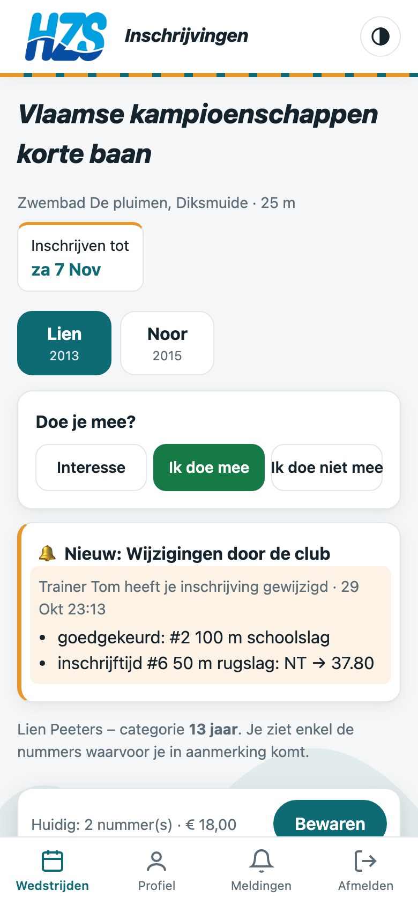
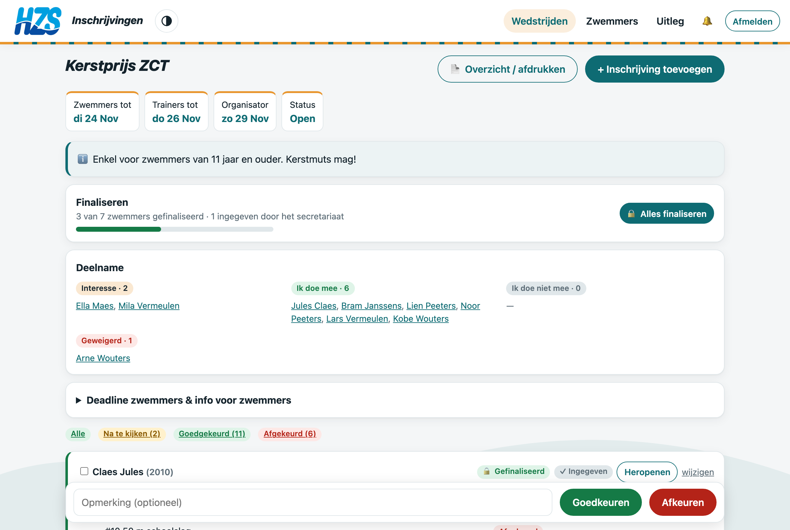

# HZS inschrijvingen

Inschrijfsysteem (PWA) voor zwemwedstrijden van Hasseltse Zwemvereniging Spartacus.

- **Sportsecretaris**: Lenex-uitnodiging (.lxf/.lef) uploaden → programma, deadline en limieten worden ingelezen; deadline secretariaat instellen; inschrijvingen exporteren als Lenex + Excel.
- **Trainers**: extra dagen instellen, inschrijvingen nakijken, goed-/afkeuren en aanpassen.
- **Zwemmers**: profiel + beste tijden, interesse/ik doe mee/ik doe niet mee, inschrijven op nummers waarvoor ze in aanmerking komen.
- Pushmeldingen (instelbaar): nieuwe wedstrijd, inschrijvingen open, 1 dag voor de deadline, wijziging door de club.
- Beste tijden via import van uitslagen-Lenexen; deelname weigeren met melding; info per wedstrijd; backup & terugzetten.

Deadline zwemmers = deadline organisator − dagen secretariaat − dagen trainer.

## Documentatie

PDF's met screenshots, altijd bijgewerkt bij elke versie:

- [Volledige documentatie](docs/pdf/HZS-inschrijvingen-documentatie.pdf)
- Handleidingen: [zwemmers & ouders](docs/pdf/handleiding-zwemmer.pdf) · [trainers](docs/pdf/handleiding-trainer.pdf) · [sportsecretaris](docs/pdf/handleiding-sportsecretaris.pdf)
- Onepagers: [zwemmers](docs/pdf/onepager-zwemmer.pdf) · [trainers](docs/pdf/onepager-trainer.pdf) · [sportsecretaris](docs/pdf/onepager-sportsecretaris.pdf)
- [Technische documentatie](docs/pdf/technisch.pdf)

Opnieuw bouwen (screenshots + PDF's): `.venv/bin/python docs/build.py`

| | |
|---|---|
|  |  |

## Lokaal draaien

```bash
uv venv --python 3.12 .venv && uv pip install --python .venv -r requirements.txt
.venv/bin/python manage.py migrate
.venv/bin/python manage.py demodata      # demo-accounts, zie inschrijvingen/management/commands/demodata.py
.venv/bin/python manage.py runserver
.venv/bin/python manage.py test inschrijvingen
```

## Productie

Debian 12 LXC met Postgres, gunicorn, nginx en cloudflared (`deploy/`).
De container haalt elke 10 minuten nieuwe commits op `main` op en installeert ze (`deploy/auto_update.sh`),
met terugrol bij een mislukte update. Het eerste account dat zich registreert wordt sportsecretaris.
