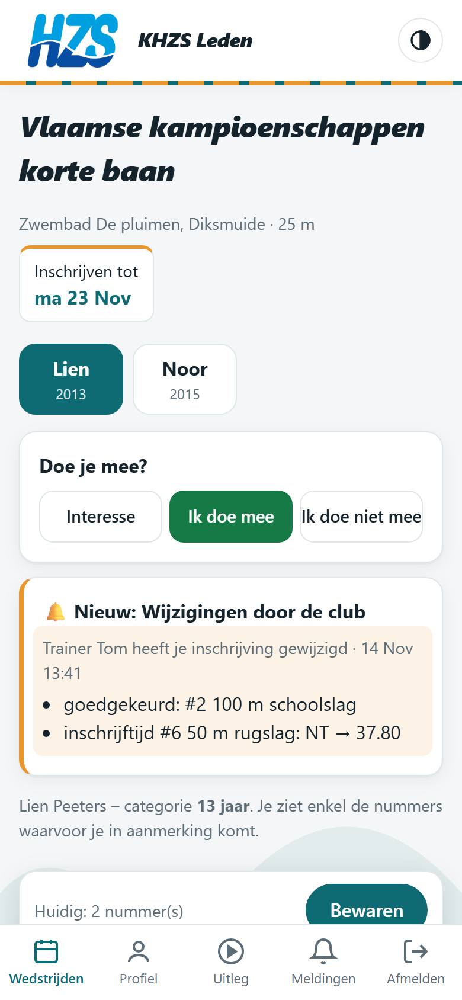
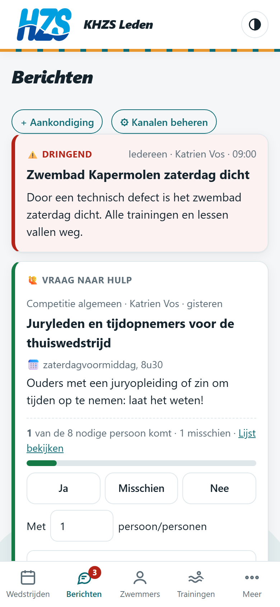

# KHZS Leden

Ledenapp (PWA) van de Hasseltse Zwemvereniging Spartacus. De repo bevat twee versies:

| Versie | Map | Status |
|---|---|---|
| **Django-app** | `inschrijvingen/`, `config/`, `templates/`, `static/`, `deploy/` | in productie op `inschrijvingen.khzs.be` |
| **WordPress-plugin KHZS Leden** | [`wordpress/`](wordpress/README.md) | klaar, nog niet op www.khzs.be; [demo](https://khzs.be/leden-demo/) |

Beide versies werken voor de inschrijvingen hetzelfde. De plugin heeft daarnaast de modules **Trainers** en **Communicatie** en de synchronisatie met de websitekalender. Wie verder werkt aan de plugin, leest eerst [`wordpress/OVERDRACHT.md`](wordpress/OVERDRACHT.md).

## Functies

**Beide versies**
- **Wedstrijden** (sportsecretaris): Lenex-uitnodiging (.lxf/.lef) uploaden → programma, deadline en limieten worden ingelezen; deadline secretariaat instellen; inschrijvingen exporteren als Lenex + Excel; bijlagen en info per wedstrijd.
- **Inschrijven** (zwemmers en ouders): interesse / ik doe mee / ik doe niet mee, inschrijven op nummers waarvoor de zwemmer in aanmerking komt; beste tijden via import van uitslagen-Lenexen.
- **Nakijken** (trainers competitie): goed- en afkeuren, aanpassen, finaliseren, deelname weigeren, overzicht afdrukken.
- **Meerdere rollen per account**: zwemmer, ouder, trainer competitie, trainer zwemschool, bestuurder, sportsecretaris, beheerder. Leden vragen een rol aan; bestuur, sportsecretariaat en beheer keuren goed, keuren af of geven een andere rol (`inschrijvingen/rollen.py`).
- **Ploegen** (competitie of zwemschool): de zwemmer of ouder kiest, een trainer van de ploeg of het bestuur keurt goed. Trainers en bestuur zien alle ploegen, leden enkel de hunne (`inschrijvingen/ploegen.py`). Een trainer van de zwemschool ziet geen wedstrijden.
- **Registratie in stappen** (`/welkom/`): eerst het account, daarna *Zwem je zelf?*, *Heb je kinderen die zwemmen?* (met ploeg of koppelcode) en *Help je mee bij de club?*.
- **Zwemmer delen** met meerdere accounts (bv. gescheiden ouders) via een koppelcode.
- **Pushmeldingen** (Web Push, per soort instelbaar): nieuwe wedstrijd, inschrijvingen open, deadline, wijziging door de club, aanvragen voor een rol of ploeg.
- **AVG**: privacyverklaring met versie en akkoord, toestemming van een ouder voor minderjarigen, *Mijn gegevens* (download en account verwijderen), dagelijkse opkuis; enkel noodzakelijke cookies.
- **Webshopknop** naar de clubwinkel (Robsport), backup en terugzetten.

Deadline zwemmers = deadline organisator − dagen secretariaat − dagen trainer.

**Enkel in de WordPress-plugin**
- **Trainers**: rooster met ploegen, seizoenen en verlof per ploeg; eigen schema, afmelden en vervangen; *Was je aanwezig?* na elke training; kalender per dag, week en maand; uren en verloning (penningmeester); aanwezigheid van zwemmers aanduiden, met statistiek en Excel.
- **Communicatie** (*Berichten*): secties → kanalen (per ploeg, per wedstrijd) → threads, vastpinnen, @vermelden, aankondigingen (*Informatief*, *Dringend*, *Aankondiging*, *Vraag naar hulp* met Ja/Misschien/Nee en aantal personen), voor een of meer kanalen tegelijk.
- **Websitekalender**: wedstrijden synchroon met The Events Calendar.
- **Eigen domein** (bv. `leden.khzs.be`) via een Cloudflare Worker, en **automatische updates** via GitHub-releases.

## Documentatie

PDF's met screenshots per rol (bron: `docs/bronnen/*.md`):

- [Volledige documentatie](docs/pdf/KHZS-Leden-documentatie.pdf)
- Handleidingen: [zwemmers & ouders](docs/pdf/handleiding-zwemmer.pdf) · [trainers](docs/pdf/handleiding-trainer.pdf) · [bestuur](docs/pdf/handleiding-bestuur.pdf) · [sportsecretaris](docs/pdf/handleiding-sportsecretaris.pdf) · [beheerder](docs/pdf/handleiding-beheerder.pdf)
- Onepagers: [zwemmers & ouders](docs/pdf/onepager-zwemmer.pdf) · [trainers](docs/pdf/onepager-trainer.pdf) · [sportsecretaris](docs/pdf/onepager-sportsecretaris.pdf)
- [Technische documentatie](docs/pdf/technisch.pdf) · [WordPress-plugin](wordpress/README.md) · [Overdracht](wordpress/OVERDRACHT.md)

Instructiefilmpjes met voice-over: [zwemmers & ouders](docs/video/zwemmer.mp4) · [trainers](docs/video/trainer.mp4) · [sportsecretaris](docs/video/sportsecretaris.mp4). Ze tonen nog de registratie van vóór het stappenplan en niets van rollen, ploegen of de modules van de plugin.

Opnieuw bouwen: `.venv/bin/python docs/build.py` (screenshots van de Django-app + PDF's), `docs/demo_screenshots.py` (schermen van de plugin, van een lokale demo) en `docs/video.py` (filmpjes). Op Windows: `.venv\Scripts\python` met `PYTHONUTF8=1`.

| | |
|---|---|
|  |  |

## Lokaal draaien (Django)

```bash
uv venv --python 3.12 .venv && uv pip install --python .venv -r requirements-dev.txt
.venv/bin/python -m playwright install chromium   # enkel voor docs en filmpjes
.venv/bin/python manage.py migrate
DJANGO_DEBUG=1 .venv/bin/python manage.py demodata   # demo-accounts (wachtwoord demo), zie docs/bronnen/technisch.md
.venv/bin/python manage.py runserver
.venv/bin/python manage.py test inschrijvingen       # 125 tests
```

De WordPress-plugin test je met een lokale testsite: zie [`wordpress/README.md`](wordpress/README.md#testen) (152 end-to-endtests).

## Productie (Django)

Debian 12 LXC met Postgres, gunicorn, nginx en cloudflared (`deploy/`).
De container haalt elke 10 minuten nieuwe commits op `main` op en installeert ze (`deploy/auto_update.sh`),
met terugrol bij een mislukte update. **Werk dus altijd op een branch en merge pas na akkoord.**
Het allereerste account dat zich registreert, wordt sportsecretaris.
