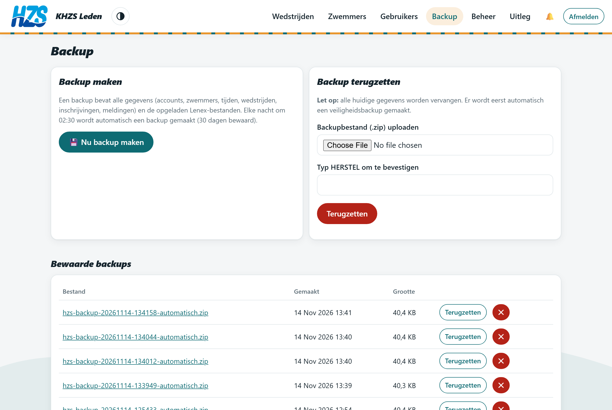

# Handleiding beheerder

De **beheerder** zorgt voor het technische beheer: backups, instellingen, rollen en het beheerpaneel. Hij of zij heeft alle rechten van het sportsecretariaat en het bestuur.

De app bestaat in twee versies met dezelfde inschrijvingen:
- de **Django-versie** (nu in productie, eigen server, `inschrijvingen.khzs.be`);
- de **WordPress-plugin KHZS Leden** (op de website van de club, `/leden/`), met daarnaast de modules *Trainers* en *Communicatie* en de websitekalender.

## 1. Account

**Django**
- Gebruikersnaam: **`admin`**, met een sterk wachtwoord. Wijzig het na de eerste aanmelding via `/beheer/` → *Wachtwoord wijzigen*.
- Een nieuw wachtwoord of een extra beheerder maken kan ook in de container: `manage.py beheerder --gebruiker admin`.

**WordPress**
- Elke WordPress-beheerder is ook beheerder in de app. Andere accounts zijn gewone WordPress-gebruikers met een rol in de app.

In beide versies maak je iemand beheerder via **Gebruikers** → **+ rol** → *Beheerder*. Enkel een beheerder kan dat.

## 2. Rollen

Een account kan meerdere rollen hebben; de rechten tellen samen. Leden vragen rollen aan in het stappenplan of via *Mijn rollen*; het bestuur, het sportsecretariaat en de beheerder keuren goed (zie *Handleiding bestuur*).

| Rol | Kan |
|---|---|
| Zwemmer, ouder | Eigen zwemmers beheren, zwemmers delen met een tweede account (koppelcode), ploeg kiezen, deelname kiezen, inschrijven tot de deadline. Ziet geen bedragen |
| Trainer competitie | Inschrijvingen nakijken en aanpassen, deelname weigeren, uitslagen importeren, info per wedstrijd, alle ploegen; *WordPress*: trainingen, aanwezigheid, berichten |
| Trainer zwemschool | Ploegen van de zwemschool, geen wedstrijden; *WordPress*: trainingen, aanwezigheid, berichten |
| Bestuurder | Gebruikers en rollen, ploegen; *WordPress*: trainers opvolgen, trainingen beheren, kanalen en aankondigingen |
| Sportsecretaris | Alles van de trainer competitie + wedstrijden opladen, instellingen, export, gebruikers en rollen, ploegen |
| Beheerder | Alles + backups, beheerpaneel of instellingen, beheerders aanstellen, penningmeester aanduiden |

**Penningmeester** (enkel WordPress) is geen rol maar een vlag die de beheerder zet bij *Gebruikers* of op het WordPress-profiel. De penningmeester ziet **Verloning**.

## 3. Backup

Menu **Backup**:

- **Nu backup maken**: een zip met alle gegevens van de app (accounts, rollen, ploegen, zwemmers, tijden, wedstrijden, inschrijvingen, meldingen) en de opgeladen bestanden.
- Elke nacht om 02:30 volgt automatisch een backup (30 dagen bewaard). Django maakt daarnaast om 03:15 een databasedump.
- **Downloaden**: klik op de bestandsnaam. Bewaar regelmatig een kopie buiten de server.
- **Terugzetten**: kies een bewaarde backup of upload een zip, en typ `HERSTEL`. Alle huidige gegevens worden vervangen. Daarvoor maakt de app eerst nog een veiligheidsbackup.

In WordPress bevat de backup de gegevens van de app, niet de WordPress-accounts zelf.

## 4. Beheerpaneel en instellingen

**Django**: via **Beheer** (`/beheer/`) zie en wijzig je alle gegevens rechtstreeks. Gebruik het enkel als het via de gewone schermen niet lukt. De instellingen staan in `/etc/khzs.env` op de server, bv. de clubnaam, de link naar de **webshop** (`CLUB_WEBSHOP`, leeg = geen knop) en de gegevens voor de privacyverklaring.

**WordPress**: *Instellingen → KHZS Leden* in wp-admin:
- welke **modules** aanstaan (Inschrijvingen, Trainers, Communicatie);
- clubnaam en clubcode, het adres van de app en eventueel een **eigen domein** (bv. `leden.khzs.be`);
- of leden zelf mogen registreren, en de installatiemelding van de app;
- de link naar de **webshop** (leeg = geen knop);
- de gegevens voor de **privacyverklaring** en de versie ervan;
- de stand van de **websitekalender** met de knop *Nu alles synchroniseren*.

**Updates**: de plugin haalt nieuwe versies zelf op van GitHub. Zet in de pluginlijst bij KHZS Leden **Automatische updates inschakelen** aan; met *Op updates controleren* kijk je meteen.

## 5. Privacy (AVG)

- De **privacyverklaring** is een sjabloon: vul de gegevens van de club in (juridische naam, adres, ondernemingsnummer, contactadres) en laat de tekst juridisch nakijken.
- Verander je de inhoud, zet dan een **nieuwe versie**. Alle leden krijgen dan een melding om ze opnieuw te lezen en te bevestigen.
- Leden downloaden hun gegevens en verwijderen hun account zelf onder **Mijn gegevens**.
- De dagelijkse **opkuis** wist oude meldingen en aanvragen (365 dagen), pushabonnementen van accounts die een jaar niet aanmeldden en verlopen koppelcodes. In WordPress ook berichten ouder dan 2 jaar (behalve vastgepinde) en, na de bewaarplicht van de boekhouding, afgesloten trainersaccounts.
- De app zet enkel strikt noodzakelijke cookies: geen cookiebanner nodig voor de app zelf.
