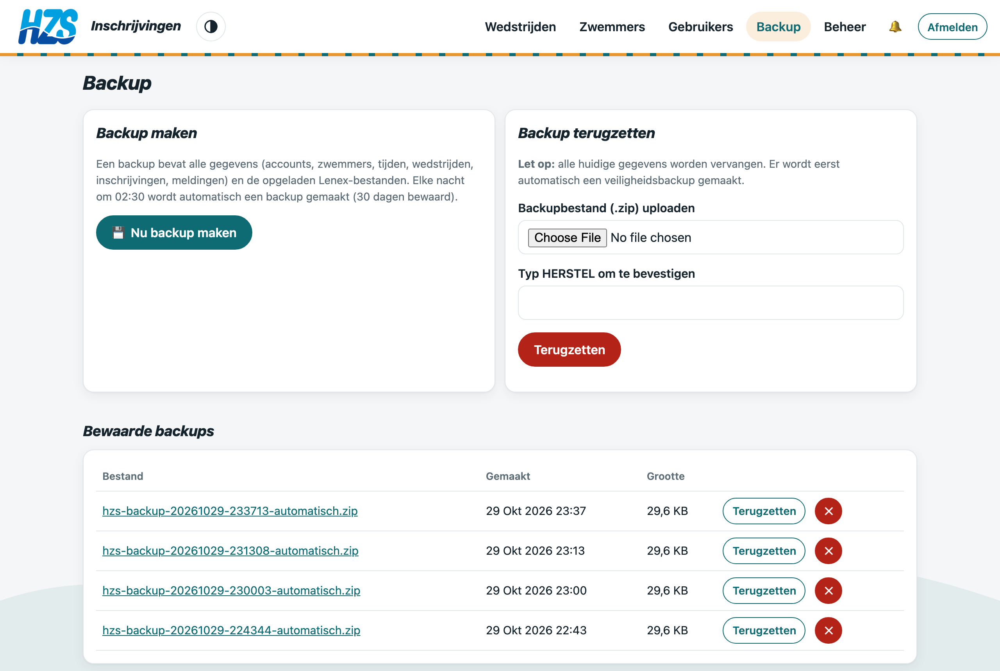

# Handleiding beheerder

De **beheerder** zorgt voor het technische beheer: backups, gebruikers en het beheerpaneel. Hij of zij heeft ook alle rechten van het sportsecretariaat.

## 1. Account

- Gebruikersnaam: **`admin`**, met een sterk wachtwoord. Wijzig het na de eerste aanmelding via `/beheer/` → *Wachtwoord wijzigen*.
- Een nieuw wachtwoord of een extra beheerder maken kan ook in de container: `manage.py beheerder --gebruiker admin`.
- Andere gebruikers maak je beheerder via **Gebruikers** → rol *Beheerder*. Enkel een beheerder kan dat.

## 2. Backup

Menu **Backup**:

- **Nu backup maken**: een zip met alle gegevens (accounts, zwemmers, tijden, wedstrijden, inschrijvingen, meldingen) en de opgeladen Lenex-bestanden.
- Elke nacht om 02:30 volgt automatisch een backup (30 dagen bewaard), plus een aparte databasedump om 03:15.
- **Downloaden**: klik op de bestandsnaam. Bewaar regelmatig een kopie buiten de server.
- **Terugzetten**: kies een bewaarde backup of upload een zip, en typ `HERSTEL`. Alle huidige gegevens worden vervangen. Daarvoor maakt de app eerst nog een veiligheidsbackup.

## 3. Beheerpaneel

Via **Beheer** (`/beheer/`) zie en wijzig je alle gegevens rechtstreeks: gebruikers, zwemmers, wedstrijden, inschrijvingen en meldingen. Gebruik het enkel als het via de gewone schermen niet lukt.

## 4. Rollen

| Rol | Kan |
|---|---|
| Zwemmer | Eigen zwemmers beheren, deelname kiezen, inschrijven tot de deadline. Ziet geen bedragen |
| Trainer | Inschrijvingen nakijken, aanpassen, deelname weigeren, uitslagen importeren, info per wedstrijd |
| Sportsecretaris | Alles van de trainer + wedstrijden opladen, instellingen, export, gebruikersrollen |
| Beheerder | Alles van de sportsecretaris + backups, beheerpaneel, beheerders aanstellen |
