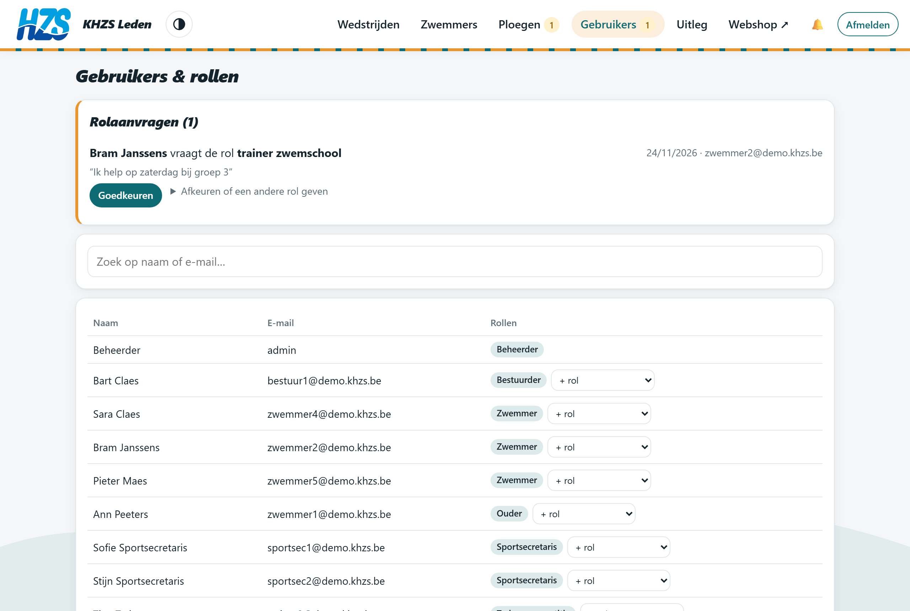
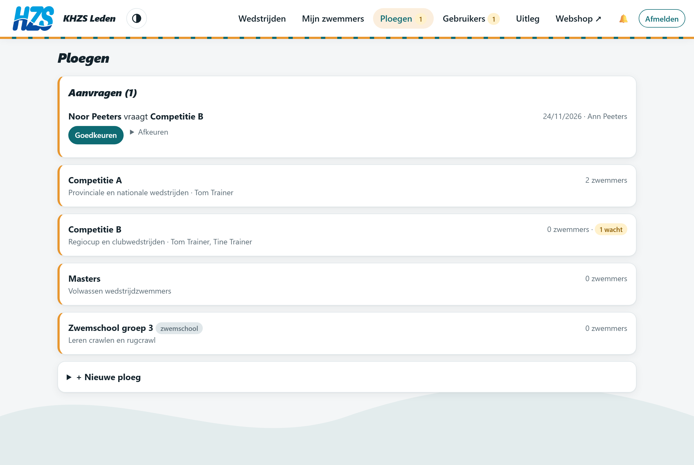
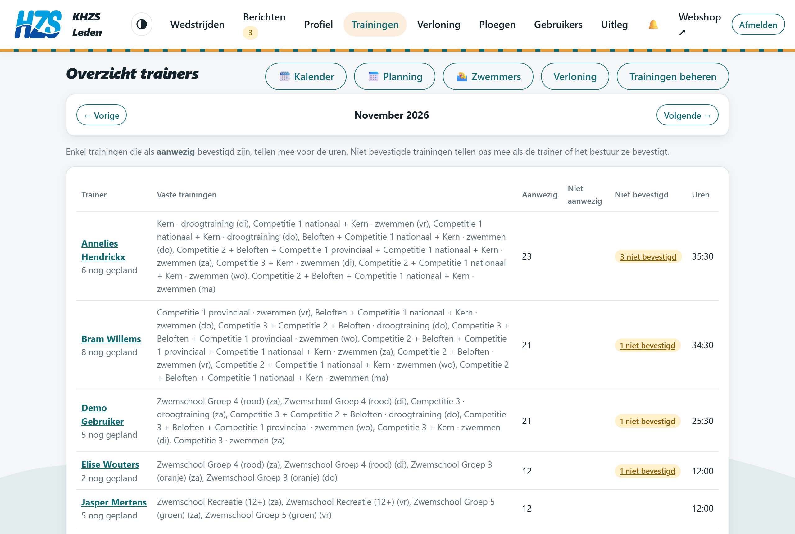
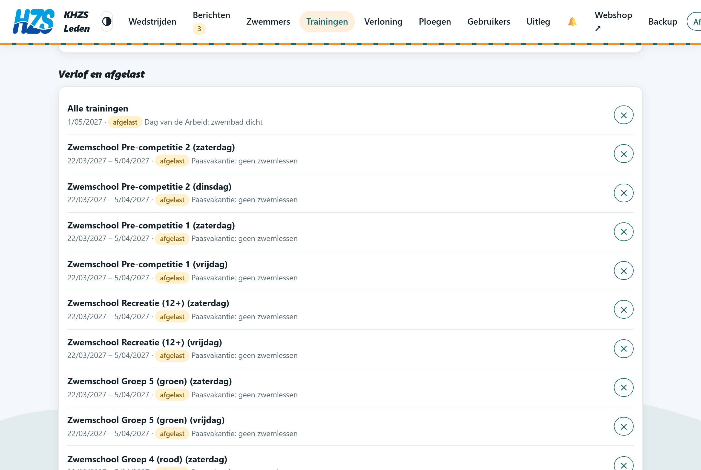
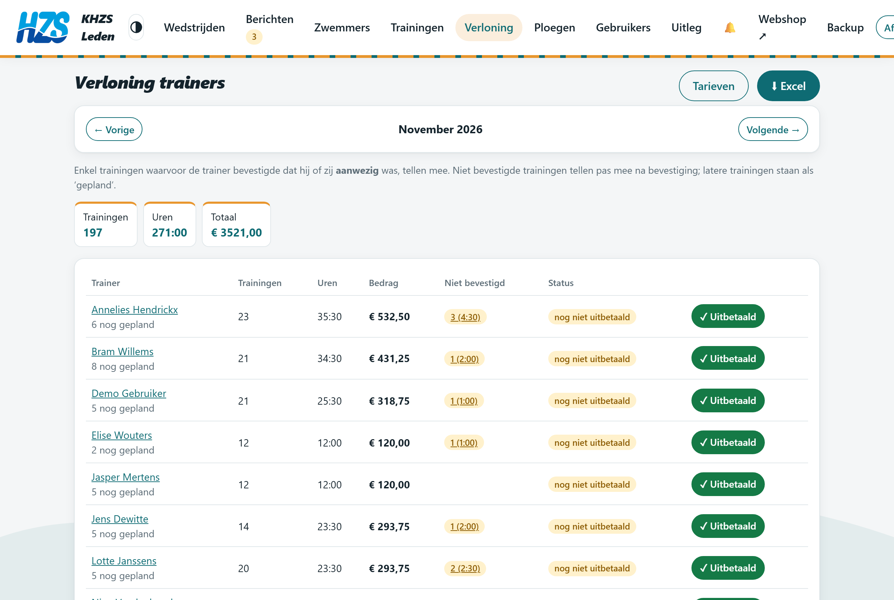
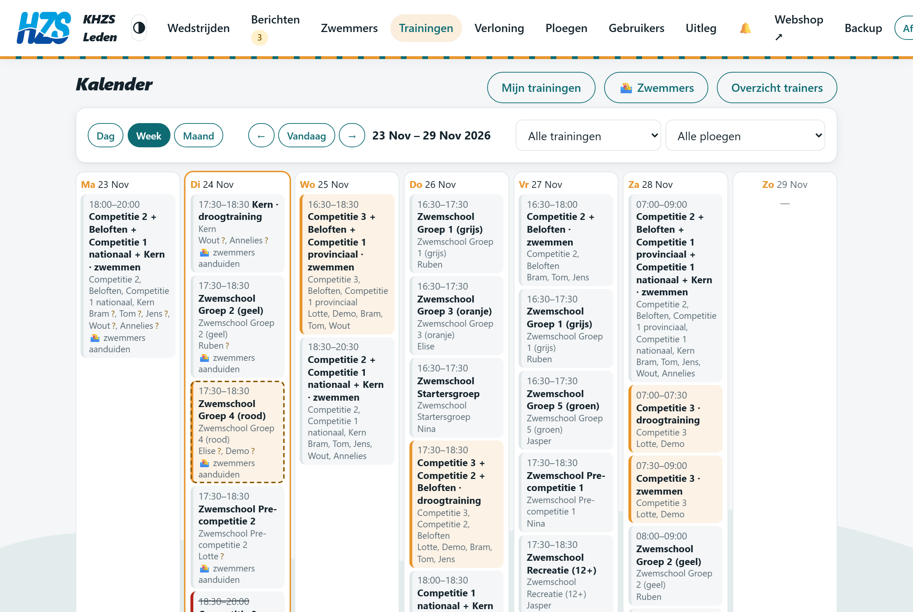
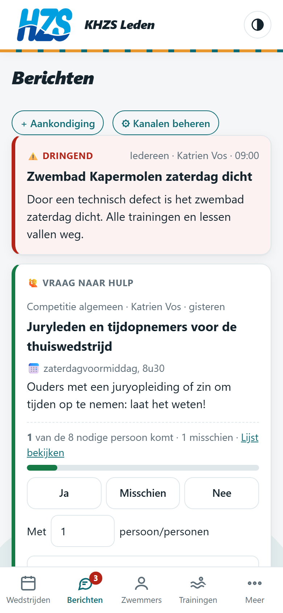
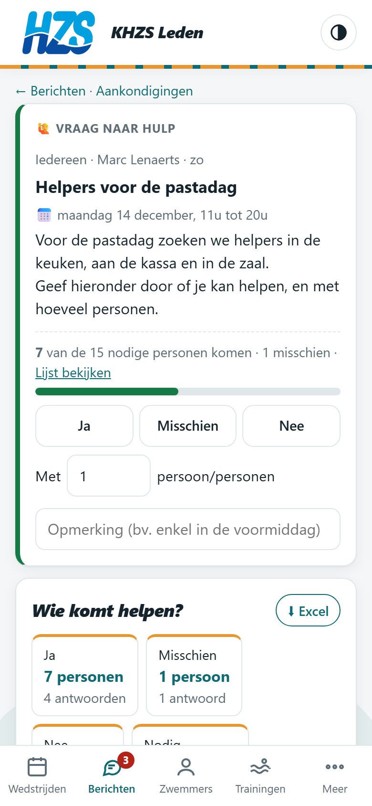

# Handleiding bestuur

Als **bestuurder** beheer je de leden van de club: je behandelt aanvragen voor rollen en ploegen en beheert de ploegen. In de WordPress-versie van de app volg je ook de trainers op en beheer je de berichten.

> De rol *bestuurder* geeft geen toegang tot wedstrijden, inschrijvingen, uitslagen of backups. Ben je ook trainer, sportsecretaris of ouder, dan heb je die rechten erbij: de rechten van al je rollen tellen samen.

> Onderdelen in een **blauw kader** bestaan enkel in de **WordPress-versie** van de app (op de website van de club).

## 1. De rol bestuurder krijgen

1. Maak een account aan via **Maak een profiel aan**.
2. Duid in het stappenplan bij **Help je mee bij de club?** *Bestuurder* aan (later: **Meldingen → Mijn rollen**).
3. Een ander bestuurslid, de sportsecretaris of de beheerder keurt je aanvraag goed.

## 2. Gebruikers en rollen

Onder **Gebruikers** (in het menu staat een getal als er aanvragen wachten) zie je alle accounts met hun rollen.

**Rolaanvragen** staan bovenaan. Per aanvraag:
- **Goedkeuren**: het lid krijgt de rol;
- **Afkeuren**: vul een reden in, het lid ziet die;
- **Deze rol geven**: geef een andere rol in de plaats (bv. *Trainer zwemschool* in plaats van *Trainer competitie*).

Het lid krijgt een melding in de app en een pushmelding.

**Rollen rechtstreeks aanpassen** in de tabel: ✕ naast een rol neemt ze af, **+ rol** voegt er een toe. Een account houdt altijd minstens één rol. Ken je een rol toe waarvoor een aanvraag openstaat, dan is die aanvraag meteen goedgekeurd. Beheerders kan enkel een beheerder aanstellen.

| Rol | Kan |
|---|---|
| Zwemmer, ouder | eigen zwemmers, inschrijven, ploeg kiezen (krijg je zonder goedkeuring) |
| Trainer competitie | inschrijvingen nakijken, uitslagen, ploegen; trainingen (WordPress) |
| Trainer zwemschool | ploegen van de zwemschool; trainingen (WordPress); geen wedstrijden |
| Bestuurder | gebruikers en rollen, ploegen; trainers en berichten (WordPress) |
| Sportsecretaris | wedstrijden, export, gebruikers en rollen, ploegen |
| Beheerder | alles, plus backup en instellingen |

## 3. Ploegen beheren

Onder **Ploegen** beheer je de ploegen en trainingsgroepen.

1. **Nieuwe ploeg**: naam, beschrijving en soort: **competitie** of **zwemschool**. Trainers van de zwemschool zien alle ploegen van de zwemschool.
2. Duid de **trainers** van de ploeg aan. Zij behandelen de aanvragen voor hun ploeg.
3. **Aanvragen** (bovenaan de lijst en per ploeg): **Goedkeuren** of **Afkeuren** met een reden.
4. Per ploeg: een zwemmer rechtstreeks **toevoegen**, **uit de ploeg** halen, de ploeg **bewerken**, **archiveren** (vinkje *Actief* uit: de indeling blijft bewaard) of **verwijderen**.

Trainers, bestuur en sportsecretariaat zien alle ploegen; zwemmers en ouders enkel de ploegen van hun eigen zwemmers.

## 4. Trainers opvolgen

Onder **Trainingen → Overzicht trainers** zie je per maand per trainer het schema, het aantal trainingen aanwezig, niet aanwezig en *niet bevestigd*, en de uren.

- Per trainer: alle trainingen van de maand met **Aanwezig** / **Niet aanwezig**, en *Alle niet bevestigde als aanwezig bevestigen*.
- Het **schema** van een trainer aanpassen (vaste trainingen toevoegen of stoppen vanaf een datum), ook in het verleden.
- Elke aanpassing komt in het logboek en de trainer krijgt een melding *Je planning is aangepast*.
- Ben je zelf ook trainer, dan gelden voor je **eigen** trainingen de regels van een trainer: na de uitbetaling corrigeert een ander bestuurslid.

**Trainingen beheren** (bestuur en sportsecretariaat):
- het **rooster**: vaste trainingen per week met dag, uur, plaats, periode en de **ploegen** van de training;
- **seizoenen** (begin en einde): buiten een seizoen zijn er geen trainingen;
- **verlof en afgelast** (vakantie, verlof, zwembad dicht…) voor alle trainingen, voor **één ploeg** of voor één training. De trainers van de trainingen die wegvallen, krijgen één melding.

**Verloning** is er voor de **penningmeester** (een vlag die de beheerder zet; de penningmeester kan ook ouder zijn):
- een **tarief** per trainer, per uur of per training, met *geldig vanaf*;
- per maand de trainingen, uren en bedragen, met *niet bevestigd* apart;
- **✓ Uitbetaald** per trainer en maand; een latere wijziging toont *gewijzigd na uitbetaling*;
- een **Excel-export** voor de boekhouding. Wettelijke plafonds (vrijwilligersvergoeding, verenigingswerk) berekent de app niet.

De **kalender** en de **statistiek van de zwemmers** (*🏊 Zwemmers*) tonen voor het bestuur alle trainingen en ploegen. In de kalender filter je op een trainer of een ploeg.

## 5. Berichten en aankondigingen

- **⚙ Kanalen beheren** (bestuur, sportsecretariaat, beheer): secties maken en hernoemen, extra kanalen maken met wie ze ziet: *Alle leden*, *Leden van de competitie*, *Leden van de zwemschool*, *Eén ploeg* of *Enkel trainers en bestuur*. Ploegkanalen en wedstrijdthreads maakt de app zelf.
- In elk kanaal: posten, vastpinnen, threads starten en berichten van anderen verwijderen.
- **+ Aankondiging** voor iedereen of voor een of meer kanalen tegelijk (vinkjes bij *Voor wie?*), met de soort *Informatief*, *Dringend*, *Aankondiging* of *Vraag naar hulp*, en optioneel *wanneer* en *bovenaan tot en met*.
- Bij een **vraag naar hulp** zie je wie *Ja*, *Misschien* of *Nee* antwoordde, met hoeveel personen, en download je de lijst als **Excel**.
- Een bestuurder ziet alle kanalen, maar krijgt enkel meldingen van de kanalen waar hij of zij bij hoort. Volg een ander kanaal met 🔔.

## 6. Meldingen voor het bestuur

Zet onder **Meldingen** aan:
- *(bestuur) Nieuwe rolaanvraag om te behandelen*;
- *(staf) Nieuwe ploegaanvraag om te behandelen*;
- in WordPress de meldingen van de berichten.
