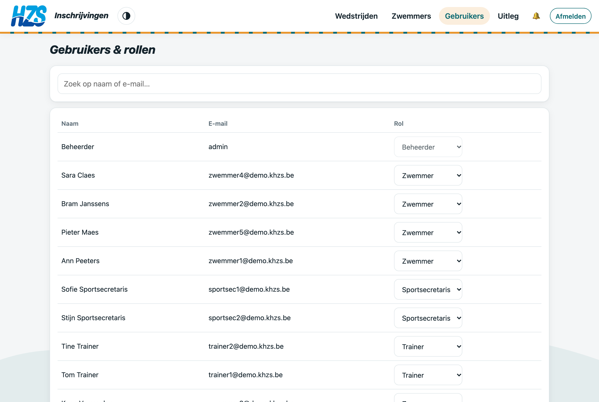
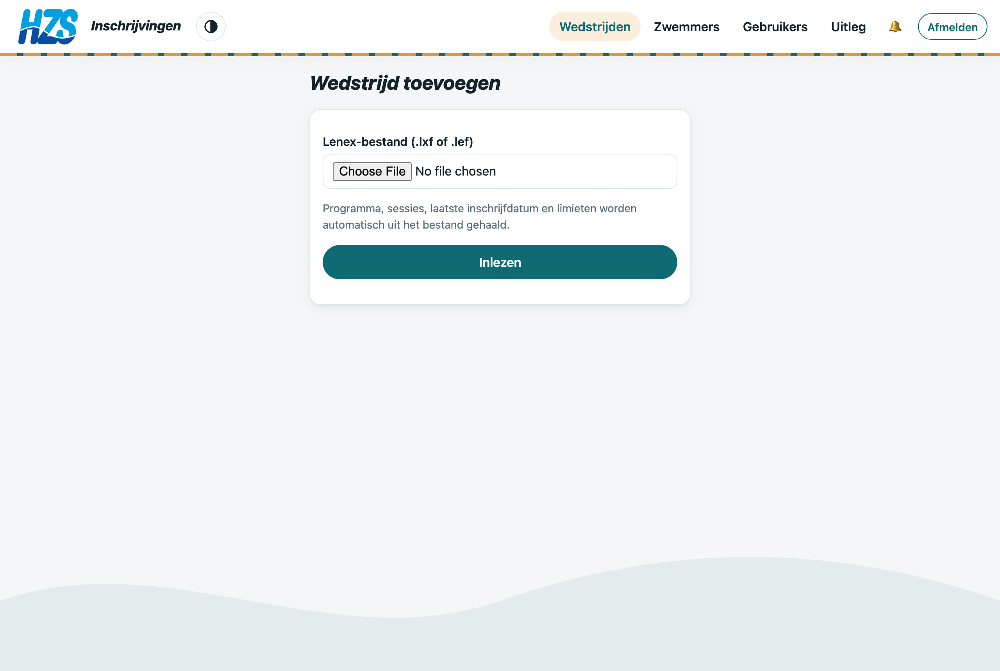
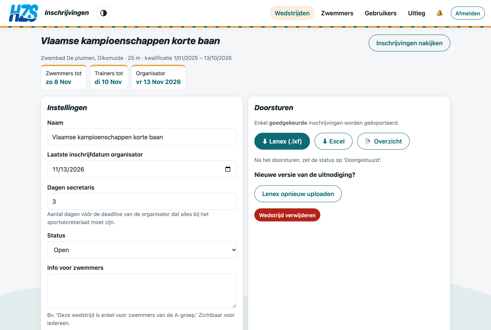
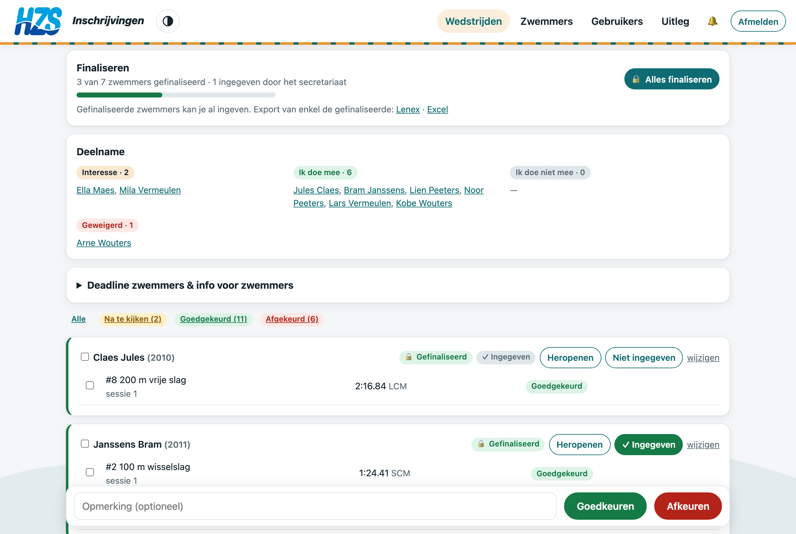
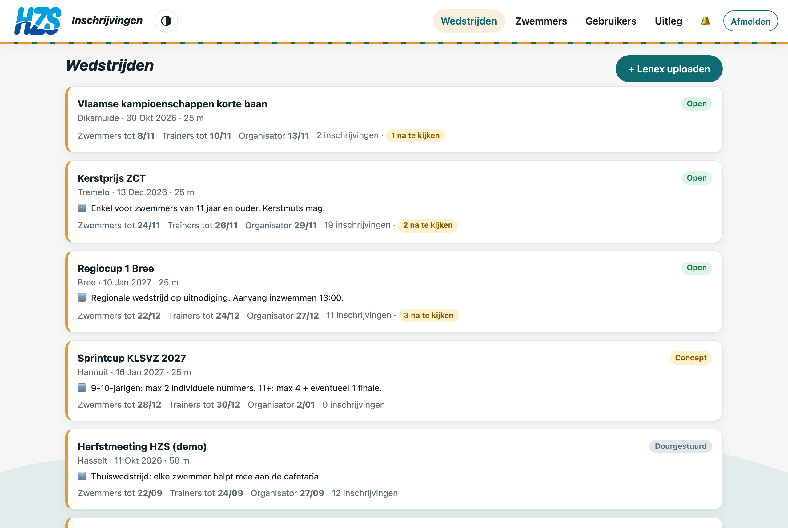
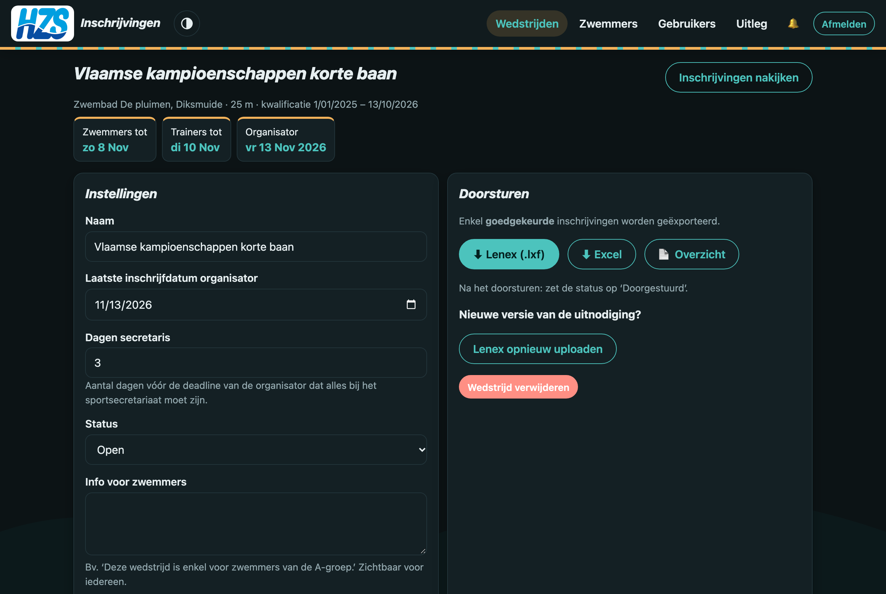

# Handleiding sportsecretaris

Als sportsecretaris laad je wedstrijden op, bepaal je de deadlines en selectiecriteria en stuur je de goedgekeurde inschrijvingen door naar de organisator.

## 1. Eerste keer

Het **eerste account** dat op een nieuwe installatie wordt aangemaakt, krijgt automatisch de rol *Sportsecretaris*.
Andere rollen (zwemmer, trainer, sportsecretaris) ken je toe onder **Gebruikers**. Beheerders kan enkel een beheerder aanstellen.

## 2. Wedstrijd opladen

1. **Wedstrijden → + Lenex uploaden**
2. Kies het `.lxf`- of `.lef`-bestand van de organisator (bv. uit SPLASH Meet Manager).
3. **Inlezen**: de app haalt automatisch op:
   - programma, sessies en nummers (met leeftijdsgroepen en kost);
   - de laatste inschrijfdatum en de leeftijdsdatum;
   - de limietlijsten (bv. *Haai*, *Orka*, *Loodsvisje*) en de kwalificatieperiode.

De wedstrijd staat eerst op **Concept**: zwemmers zien hem al en kunnen interesse opgeven, maar nog niet inschrijven. Zwemmers met meldingen aan krijgen een pushmelding.

> Ontbreekt de laatste inschrijfdatum in het bestand? Dan zet de app voorlopig 7 dagen voor de wedstrijd en krijg je een waarschuwing. Pas de datum aan bij de instellingen.

## 3. Instellingen per wedstrijd

| Veld | Uitleg |
|---|---|
| Laatste inschrijfdatum | Deadline van de organisator (uit de Lenex) |
| Dagen secretaris | Hoeveel dagen vóór die deadline alles bij jou moet zijn |
| Status | *Concept* → *Open* → *Gesloten* → *Doorgestuurd* |
| Info voor zwemmers | Vrije tekst bovenaan de wedstrijd, bv. voor wie de wedstrijd is |
| Selectiecriteria | Welke limietlijsten gehaald moeten zijn. Zonder vinkje is er geen limiet |

Zet de status op **Open** om de inschrijvingen te openen. Zwemmers met *Interesse* of *Ik doe mee* krijgen dan een melding.

## 4. Nieuwe versie van de uitnodiging

Stuurt de organisator een aangepaste Lenex? Klik bij de instellingen op **Lenex opnieuw uploaden**. Bestaande inschrijvingen en je gekozen limieten blijven behouden.

## 5. Al ingeven tijdens de inschrijfperiode

Je hoeft niet te wachten tot de deadline. Op **Inschrijvingen nakijken** zie je bovenaan hoeveel zwemmers de trainer al **gefinaliseerd** heeft:

1. Geef een gefinaliseerde zwemmer in (bv. in SPLASH) en klik **✓ Ingegeven** bij die zwemmer.
2. Wijzigt de trainer daarna nog iets? Dan verschijnt **⚠ Gewijzigd na ingave** en verdwijnt het vinkje *Ingegeven*, zodat je weet wat je nog moet aanpassen.
3. Exporteer enkel de gefinaliseerde zwemmers met de links *Lenex* / *Excel* in het blok *Finaliseren*.

Het **📄 Overzicht** (per zwemmer of per nummer) is ook handig om na te kijken of af te drukken.

## 6. Doorsturen

1. Zet na de trainersdeadline de status op **Gesloten**.
2. Klik **⬇ Lenex (.lxf)**: een inschrijvingsbestand met enkel de **goedgekeurde** inschrijvingen (zwemmers, licenties, inschrijftijden). Dat bestand importeert de organisator rechtstreeks in SPLASH.
3. Klik **⬇ Excel** voor een overzicht per nummer en per zwemmer, met de kosten.
4. Stuur het bestand naar de organisator en zet de status op **Doorgestuurd**.

## 7. Beste tijden bijhouden

Na elke wedstrijd: **Zwemmers → Uitslagen importeren** met de uitslagen-Lenex. Zo kloppen de beste tijden en de limietcontrole. Zwemmers kunnen zelf geen tijden invoeren.

## 8. Kosten

Inschrijfgelden zie je als sportsecretaris (en trainer) bij elk nummer en in de Excel-export. **Zwemmers en ouders zien geen bedragen.**

## 9. Backups

Backups en technisch beheer horen bij de aparte rol **Beheerder** (zie *Handleiding beheerder*), niet bij het sportsecretariaat.

## Uitleg en filmpjes

Onder **Uitleg** staan de instructiefilmpjes met gesproken uitleg en ondertitels, samen met de handleidingen als PDF.

## 10. Donker thema

