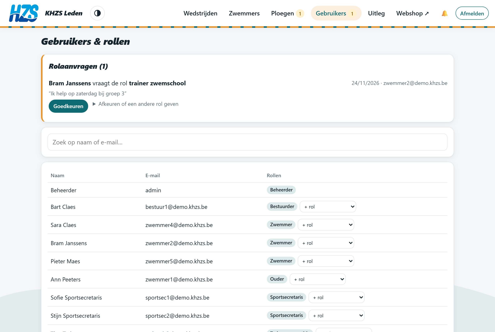
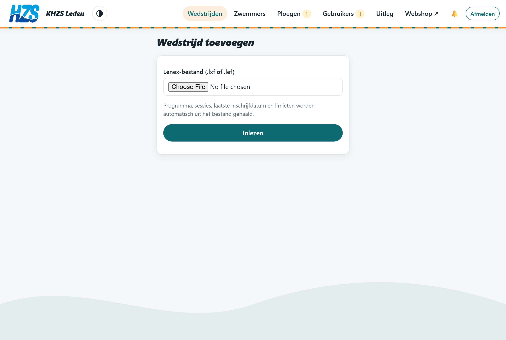
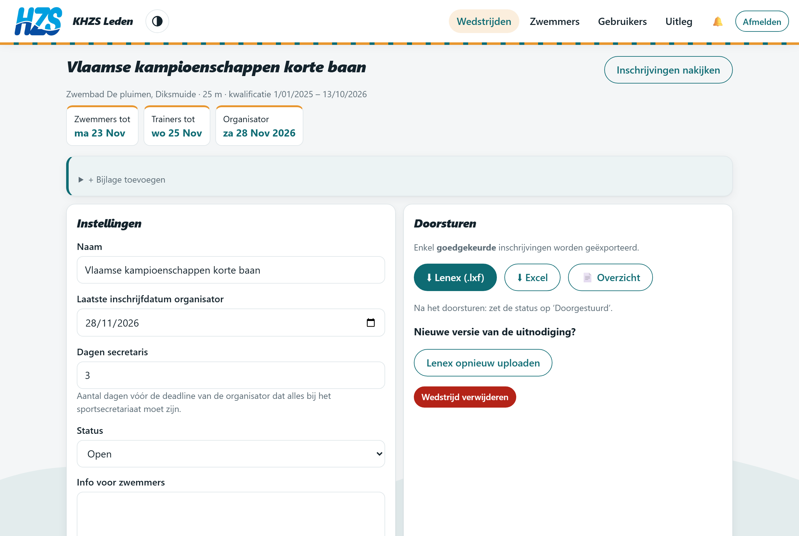
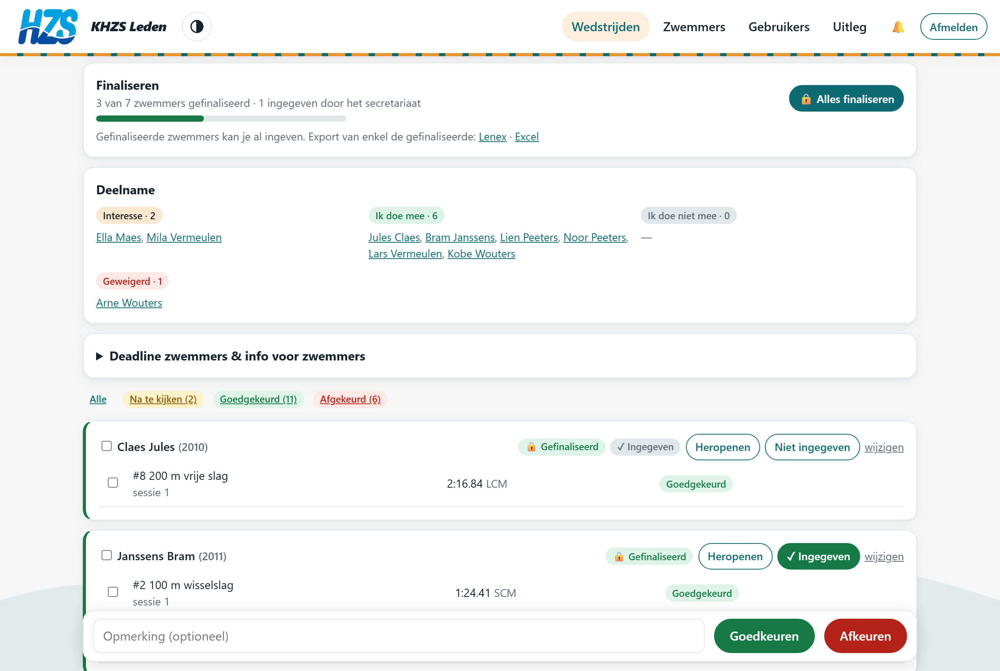
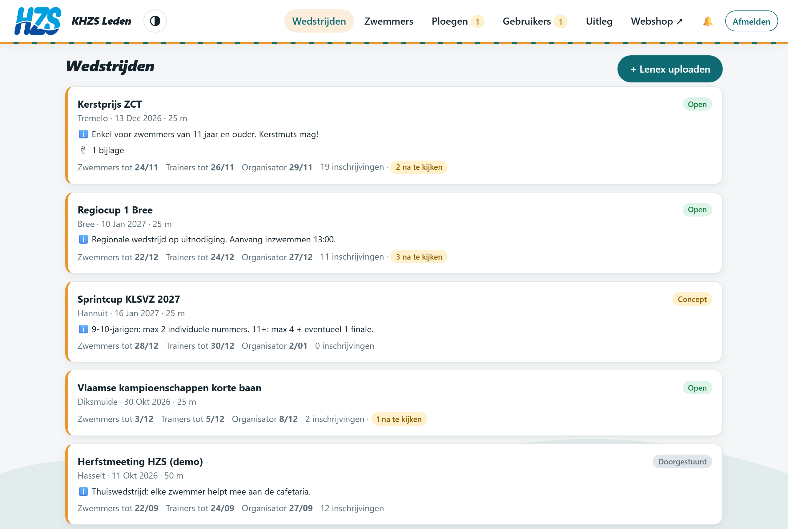
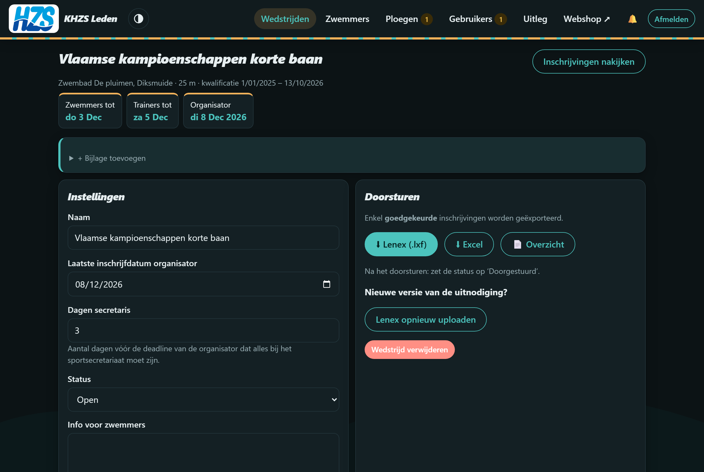

# Handleiding sportsecretaris

Als sportsecretaris laad je wedstrijden op, bepaal je de deadlines en selectiecriteria en stuur je de goedgekeurde inschrijvingen door naar de organisator. Je hebt ook alle rechten van een trainer van de competitie, en je beheert samen met het bestuur de rollen en de ploegen.

> Onderdelen in een **blauw kader** bestaan enkel in de **WordPress-versie** van de app (op de website van de club).

## 1. Eerste keer, rollen en ploegen

In de Django-versie krijgt het **allereerste account** van een nieuwe installatie automatisch de rol *Sportsecretaris*. Nieuwe leden starten zonder rol en kiezen in het stappenplan na de registratie of ze zwemmer, ouder of medewerker zijn.

- **Gebruikers & rollen**: bovenaan staan de rolaanvragen (trainer, bestuurder, sportsecretaris). Je kan **goedkeuren**, **afkeuren** met een reden of **een andere rol geven**. In de tabel neem je een rol af met ✕ of voeg je er een toe met **+ rol**. Een account kan meerdere rollen hebben. Beheerders kan enkel een beheerder aanstellen.
- **Ploegen**: ploegen aanmaken (competitie of zwemschool), trainers aanduiden en ploegaanvragen behandelen. Zie de *Handleiding bestuur*.

Volgen twee ouders dezelfde zwemmer, elk met een eigen account? Dat regelen ze zelf met een koppelcode. Je kan een account ook rechtstreeks koppelen bij de zwemmer, via **Account koppelen (staf)** (zie de handleiding voor trainers).

## 2. Wedstrijd opladen

1. **Wedstrijden → + Lenex uploaden**
2. Kies het `.lxf`- of `.lef`-bestand van de organisator (bv. uit SPLASH Meet Manager).
3. **Inlezen**: de app haalt automatisch op:
   - programma, sessies en nummers (met leeftijdsgroepen en kost);
   - de laatste inschrijfdatum en de leeftijdsdatum;
   - de limietlijsten (bv. *Haai*, *Orka*, *Loodsvisje*) en de kwalificatieperiode.

De wedstrijd staat eerst op **Concept**: zwemmers zien hem al en kunnen interesse opgeven, maar nog niet inschrijven. Zwemmers met meldingen aan krijgen een pushmelding.

> Ontbreekt de laatste inschrijfdatum in het bestand? Dan zet de app voorlopig 7 dagen voor de wedstrijd en krijg je een waarschuwing. Pas de datum aan bij de instellingen.

## 3. Instellingen per wedstrijd

| Veld | Uitleg |
|---|---|
| Laatste inschrijfdatum | Deadline van de organisator (uit de Lenex) |
| Dagen secretaris | Hoeveel dagen vóór die deadline alles bij jou moet zijn |
| Status | *Concept* → *Open* → *Gesloten* → *Doorgestuurd* |
| Info voor zwemmers | Vrije tekst bovenaan de wedstrijd, bv. voor wie de wedstrijd is |
| Bijlagen | Bovenaan de instellingen: *+ Bijlage toevoegen* (PDF, afbeelding, Word, Excel; max. 10 MB), bv. het voorprogramma als PDF of een reglement |
| Selectiecriteria | Welke limietlijsten gehaald moeten zijn. Zonder vinkje is er geen limiet |

Zet de status op **Open** om de inschrijvingen te openen. Zwemmers met *Interesse* of *Ik doe mee* krijgen dan een melding.

## 4. Nieuwe versie van de uitnodiging

Stuurt de organisator een aangepaste Lenex? Klik bij de instellingen op **Lenex opnieuw uploaden**. Bestaande inschrijvingen en je gekozen limieten blijven behouden.

## 5. Al ingeven tijdens de inschrijfperiode

Je hoeft niet te wachten tot de deadline. Op **Inschrijvingen nakijken** zie je bovenaan hoeveel zwemmers de trainer al **gefinaliseerd** heeft:

1. Geef een gefinaliseerde zwemmer in (bv. in SPLASH) en klik **✓ Ingegeven** bij die zwemmer.
2. Wijzigt de trainer daarna nog iets? Dan verschijnt **⚠ Gewijzigd na ingave** en verdwijnt het vinkje *Ingegeven*, zodat je weet wat je nog moet aanpassen.
3. Exporteer enkel de gefinaliseerde zwemmers met de links *Lenex* / *Excel* in het blok *Finaliseren*.

Het **📄 Overzicht** (per zwemmer of per nummer) is ook handig om na te kijken of af te drukken.

## 6. Doorsturen

1. Zet na de trainersdeadline de status op **Gesloten**.
2. Klik **⬇ Lenex (.lxf)**: een inschrijvingsbestand met enkel de **goedgekeurde** inschrijvingen (zwemmers, licenties, inschrijftijden). Dat bestand importeert de organisator rechtstreeks in SPLASH.
3. Klik **⬇ Excel** voor een overzicht per nummer en per zwemmer, met de kosten.
4. Stuur het bestand naar de organisator en zet de status op **Doorgestuurd**.

## 7. Beste tijden bijhouden

Na elke wedstrijd: **Zwemmers → Uitslagen importeren** met de uitslagen-Lenex. Zo kloppen de beste tijden en de limietcontrole. Zwemmers kunnen zelf geen tijden invoeren.

## 8. Kosten

Inschrijfgelden zie je als sportsecretaris (en trainer) bij elk nummer en in de Excel-export. **Zwemmers en ouders zien geen bedragen.**

## 9. Websitekalender

Staat op de website de plugin **The Events Calendar**, dan zet de app de wedstrijden op de evenementenkalender van de website en houdt ze bij. Instellen doe je onder **Wedstrijden → 📅 Websitekalender**:

- de synchronisatie aan of uit (standaard **uit**);
- welke statussen op de website komen (standaard *Open*, *Gesloten* en *Doorgestuurd*, geen *Concept*);
- de categorie van de evenementen, en of nieuwe evenementen meteen gepubliceerd worden of eerst als concept;
- of de *info voor zwemmers* mee op de website mag (standaard niet);
- de knop **Nu alles synchroniseren**.

Enkel publieke informatie gaat mee: naam, sessies, zwembad, badlengte en organisator. Nooit zwemmers, inschrijvingen, deadlines of kosten. Bijlagen gaan enkel mee als je ze als **publiek** (🌐) aanduidt. Wijzigde iemand het evenement op de website, dan overschrijft de app dat niet: je kiest *Overschrijven met de app* of *Niet meer bijwerken*. Een wedstrijd die niet meer publiek is, wordt op de website *Geannuleerd*.

## 10. Trainingen

Het sportsecretariaat beheert samen met het bestuur het trainingsrooster (**Trainingen → Trainingen beheren**: vaste trainingen, ploegen per training, seizoenen, verlof en afgelaste trainingen) en kan de planning en de aanwezigheid van elke trainer corrigeren. Zie de *Handleiding bestuur*.

## 11. Backups

Backups en technisch beheer horen bij de aparte rol **Beheerder** (zie *Handleiding beheerder*), niet bij het sportsecretariaat.

## Uitleg en filmpjes

Onder **Uitleg** staan de instructiefilmpjes met gesproken uitleg en ondertitels, samen met de handleidingen als PDF.

## 12. Donker thema

