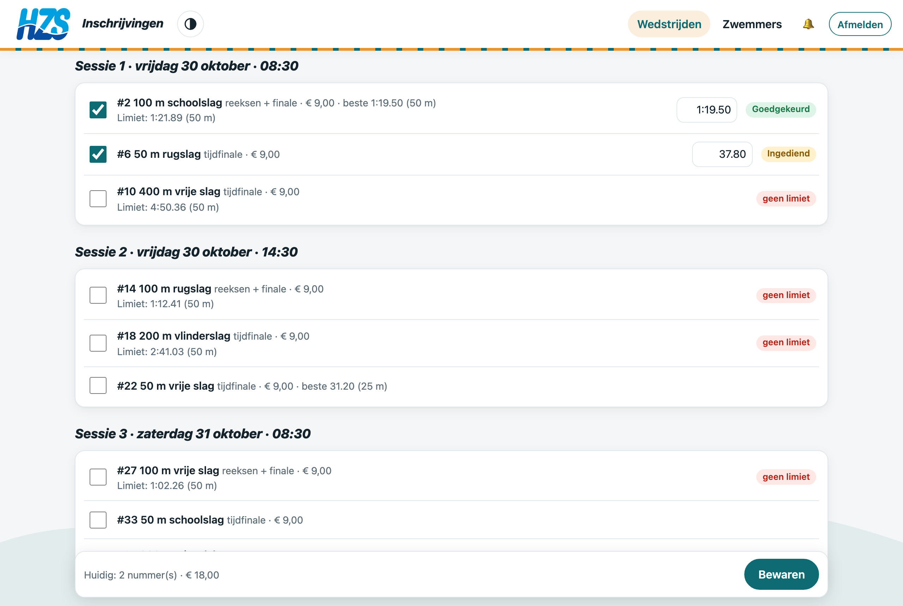
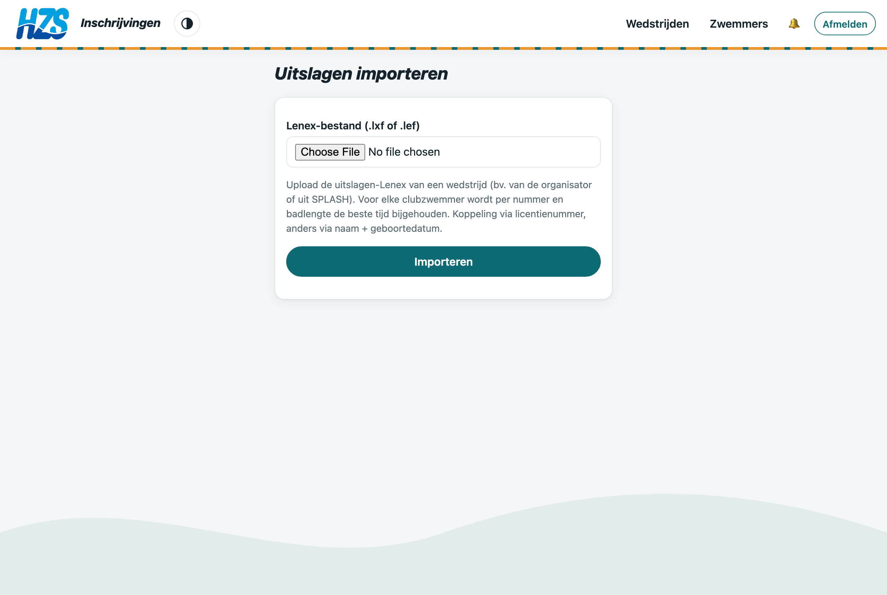
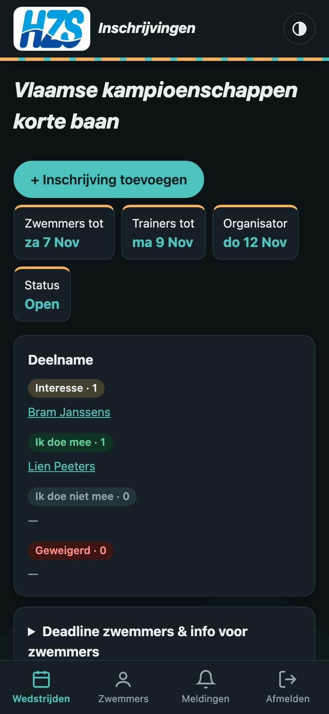

# Handleiding trainers

Als trainer kijk je de inschrijvingen van de zwemmers na. Je kan ze goedkeuren, afkeuren of zelf aanpassen. De app werkt op pc en op gsm.

## 1. Rol trainer

Maak een account aan via **Maak een profiel aan** en vraag de sportsecretaris om je de rol **Trainer** te geven.

## 2. Deadlines

Elke wedstrijd heeft drie datums:

| Deadline | Betekenis |
|---|---|
| **Organisator** | Laatste inschrijfdatum uit het Lenex-bestand |
| **Trainers** | Organisator − dagen sportsecretariaat: tot dan kan jij nog alles aanpassen |
| **Zwemmers** | Trainers − jouw extra dagen: tot dan schrijven zwemmers zelf in |

Jouw extra dagen stel je in via **Inschrijvingen nakijken → Deadline zwemmers & info voor zwemmers**.
Daar vul je ook **info voor zwemmers** in, bv. *“Deze wedstrijd is enkel voor de A-groep.”* Die tekst staat bovenaan de wedstrijd en in de lijst van wedstrijden.

## 3. Inschrijvingen nakijken

Open een wedstrijd onder **Wedstrijden**. Je ziet:

- **Deelname:** wie *Interesse*, *Ik doe mee* of *Ik doe niet mee* koos (klik op een naam om die zwemmer te openen);
- de inschrijvingen per zwemmer, met inschrijftijd en status;
- filters: *Na te kijken*, *Goedgekeurd* en *Afgekeurd*.

Vink een of meer inschrijvingen aan (of de hele zwemmer), vul eventueel een opmerking in en klik **Goedkeuren** of **Afkeuren**.

## 4. Inschrijvingen aanpassen

Klik bij een zwemmer op **wijzigen** (of gebruik **+ Inschrijving toevoegen** en kies een zwemmer):

- nummers aan- of uitvinken. Jij kan ook inschrijven op een nummer zonder limiet;
- de **inschrijftijd** aanpassen in het tijdveld naast het nummer;
- **Bewaren**: door jou toegevoegde nummers zijn meteen goedgekeurd.

De zwemmer krijgt een melding *“Trainer … heeft je inschrijving gewijzigd”*, met de details.

## 5. Deelname weigeren

Mag een zwemmer niet deelnemen? Open de zwemmer (klik op de naam bij **Deelname**). Vul een **reden** in en klik **Weigeren**:

- de zwemmer krijgt een melding in de app (en een pushmelding);
- openstaande inschrijvingen worden afgekeurd;
- de zwemmer kan niet meer inschrijven voor die wedstrijd.

Met **Opnieuw toestaan** draai je dit terug.

## 6. Beste tijden en uitslagen

Zwemmers vullen hun tijden niet zelf in. Je werkt ze bij op twee manieren:

- **Zwemmers → Uitslagen importeren**: upload de uitslagen-Lenex van een wedstrijd. Per clubzwemmer wordt de beste tijd per slag, afstand en badlengte bijgewerkt. De koppeling gebeurt via het licentienummer, anders via naam + geboortedatum. Zwemmers die niet in de app staan, worden opgelijst.
- Per zwemmer: **+ Tijd toevoegen (staf)** of een tijd wissen met ✕.

## 7. Onderweg

Alles werkt ook op je gsm, in licht of donker thema. Zet onder **Meldingen** eventueel *Nieuwe inschrijving om na te kijken* aan.

