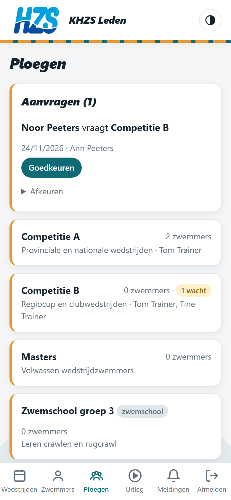
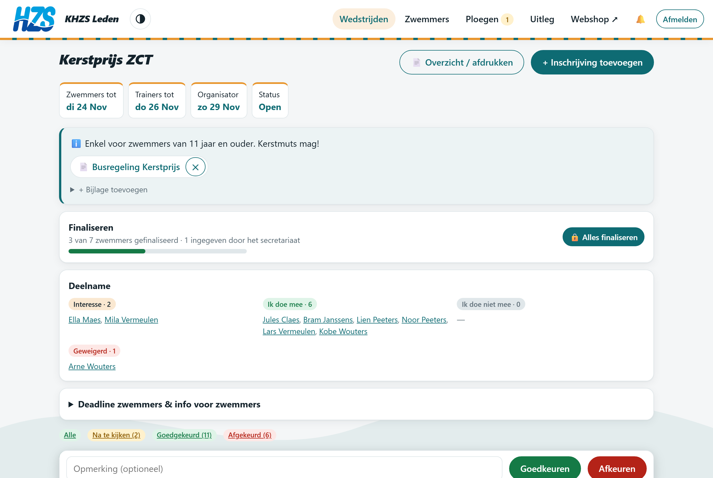
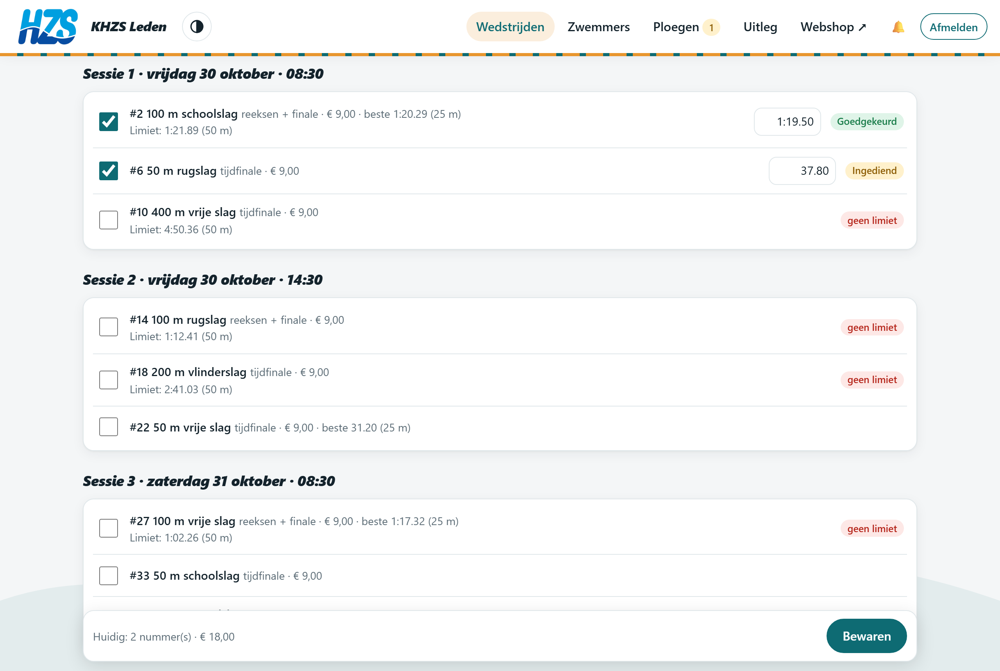
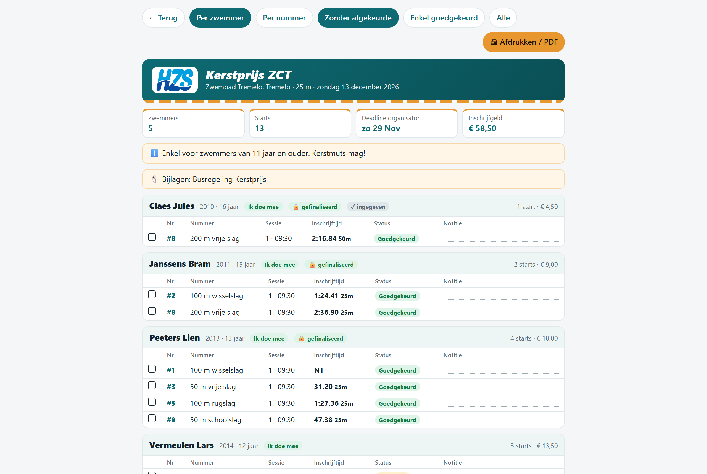
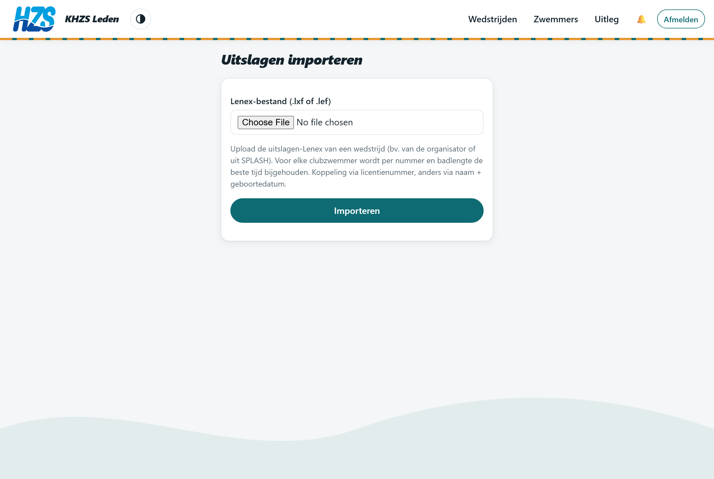
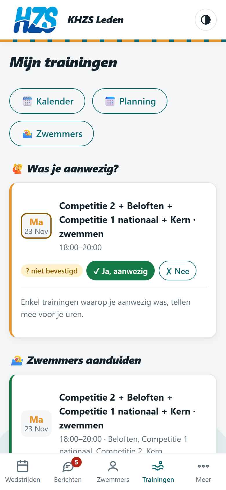
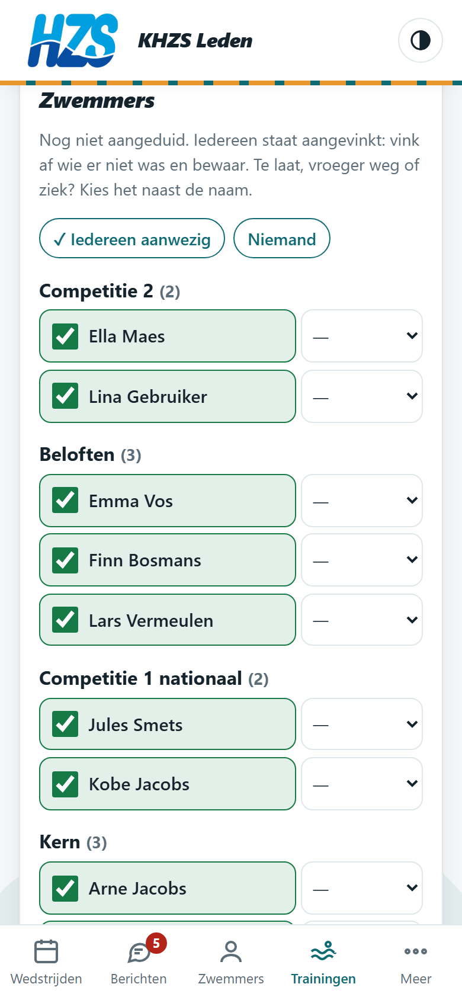
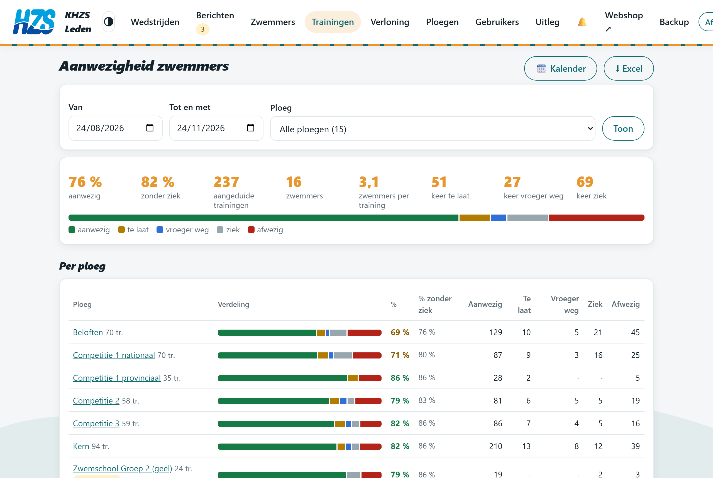
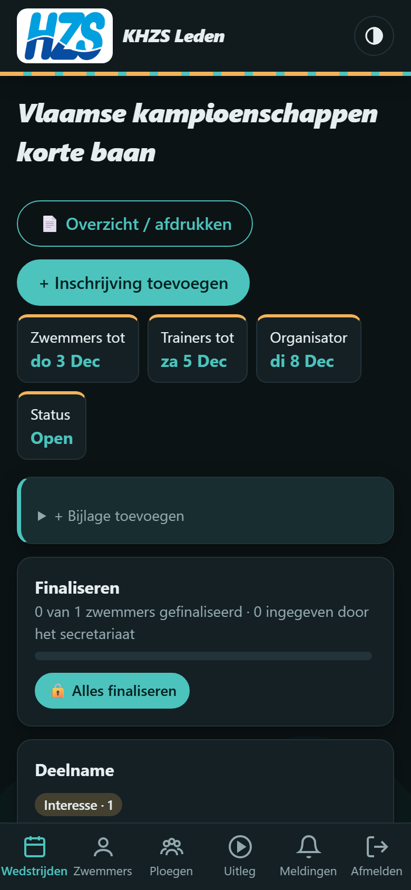

# Handleiding trainers

Als trainer volg je je ploeg op: je keurt ploegaanvragen goed en, bij de competitie, kijk je de inschrijvingen voor wedstrijden na. In de WordPress-versie van de app duid je ook je trainingen, je aanwezigheid en die van je zwemmers aan. De app werkt op pc en op gsm.

> Onderdelen in een **blauw kader** bestaan enkel in de **WordPress-versie** van de app (op de website van de club): trainingen, uren, aanwezigheid van zwemmers en berichten.

## 1. Rol trainer: competitie of zwemschool

Er zijn twee rollen voor trainers. Wie beide doet, vraagt beide rollen aan.

| Rol | Ziet en doet |
|---|---|
| **Trainer competitie** | wedstrijden, inschrijvingen nakijken en aanpassen, uitslagen, alle ploegen; in WordPress ook trainingen en berichten van de competitie |
| **Trainer zwemschool** | geen wedstrijden; de ploegen van de zwemschool en de eigen ploegen; in WordPress ook trainingen en berichten van de zwemschool |

Zo vraag je de rol aan:
1. Maak een account aan via **Maak een profiel aan**.
2. Duid in het stappenplan bij **Help je mee bij de club?** *Trainer competitie* en/of *Trainer zwemschool* aan, met eventueel een toelichting (bv. *trainer van de B-groep*). Later kan dat ook via **Meldingen → Mijn rollen**.
3. Het bestuur keurt je aanvraag goed. Je krijgt een melding en ziet daarna de extra menu's.

Ben je ook ouder of zwem je zelf? Dan zie je daarnaast alles van je eigen zwemmers. Een trainer van de zwemschool die ook ouder is, ziet de wedstrijden voor de eigen kinderen.

## 2. Je ploeg

Onder **Ploegen** zie je de ploegen. Het bestuur duidt aan wie de trainers van een ploeg zijn.

- **Aanvragen**: kiest een zwemmer of ouder jouw ploeg, dan krijg je een pushmelding. De aanvraag staat bovenaan *Ploegen* en bij de ploeg: **Goedkeuren**, of **Afkeuren** met een reden.
- Een trainer van de competitie ziet alle ploegen; een trainer van de zwemschool de ploegen van de zwemschool en de eigen ploegen.
- **Zwemmer toevoegen**: kies een zwemmer bij *Zwemmer toevoegen*. Die zit dan meteen in de ploeg.
- **Uit ploeg** haalt een zwemmer uit de ploeg.

## 3. Deadlines (competitie)

Elke wedstrijd heeft drie datums:

| Deadline | Betekenis |
|---|---|
| **Organisator** | Laatste inschrijfdatum uit het Lenex-bestand |
| **Trainers** | Organisator − dagen sportsecretariaat: tot dan kan jij nog alles aanpassen |
| **Zwemmers** | Trainers − jouw extra dagen: tot dan schrijven zwemmers zelf in |

Jouw extra dagen stel je in via **Inschrijvingen nakijken → Deadline zwemmers & info voor zwemmers**.
Daar vul je ook **info voor zwemmers** in, bv. *“Deze wedstrijd is enkel voor Competitie A.”* Die tekst staat bovenaan de wedstrijd en in de lijst van wedstrijden.

Bij de info kan je ook **bijlagen** toevoegen (*+ Bijlage toevoegen*): PDF, afbeelding, Word of Excel, max. 10 MB. Bv. een busregeling of het wedstrijdreglement. Alle aangemelde zwemmers en ouders kunnen ze openen; met ✕ verwijder je een bijlage.

## 4. Inschrijvingen nakijken

Open een wedstrijd onder **Wedstrijden**. Je ziet:

- **Deelname:** wie *Interesse*, *Ik doe mee* of *Ik doe niet mee* koos (klik op een naam om die zwemmer te openen);
- de inschrijvingen per zwemmer, met inschrijftijd en status;
- filters: *Na te kijken*, *Goedgekeurd* en *Afgekeurd*.

Vink een of meer inschrijvingen aan (of de hele zwemmer), vul eventueel een opmerking in en klik **Goedkeuren** of **Afkeuren**.

## 5. Inschrijvingen aanpassen

Klik bij een zwemmer op **wijzigen** (of gebruik **+ Inschrijving toevoegen** en kies een zwemmer):

- nummers aan- of uitvinken. Jij kan ook inschrijven op een nummer zonder limiet;
- de **inschrijftijd** aanpassen in het tijdveld naast het nummer;
- **Bewaren**: door jou toegevoegde nummers zijn meteen goedgekeurd.

De zwemmer krijgt een melding *“Trainer … heeft je inschrijving gewijzigd”*, met de details.

## 6. Finaliseren

Is de inschrijving van een zwemmer volledig nagekeken? Klik bij die zwemmer op **🔒 Finaliseren** (of bovenaan **Alles finaliseren**):

- openstaande inschrijvingen worden goedgekeurd;
- de zwemmer kan niets meer wijzigen, ook niet vóór de deadline, en krijgt een melding;
- het sportsecretariaat ziet dat de zwemmer klaar is en kan hem of haar al ingeven.

Met **Heropenen** kan de zwemmer opnieuw wijzigen tot de deadline. Pas je na het ingeven nog iets aan, dan ziet het secretariaat **⚠ Gewijzigd na ingave**.

## 7. Overzicht afdrukken

**📄 Overzicht / afdrukken** opent een overzicht van de wedstrijd, ideaal om mee te nemen naar de training voor een laatste controle:

- **Per zwemmer**: elk nummer met sessie, inschrijftijd en status, een vakje om af te vinken en een notitieregel;
- **Per nummer**: per nummer de zwemmers, gesorteerd op inschrijftijd;
- filters: *zonder afgekeurde*, *enkel goedgekeurd* of *alle*;
- onderaan de zwemmers met interesse die nog geen nummers hebben.

Met **🖨 Afdrukken / PDF** druk je het af of bewaar je het als PDF.

## 8. Deelname weigeren

Mag een zwemmer niet deelnemen? Open de zwemmer (klik op de naam bij **Deelname**). Vul een **reden** in en klik **Weigeren**:

- de zwemmer krijgt een melding in de app (en een pushmelding);
- openstaande inschrijvingen worden afgekeurd;
- de zwemmer kan niet meer inschrijven voor die wedstrijd.

Met **Opnieuw toestaan** draai je dit terug.

## 9. Beste tijden en uitslagen

Zwemmers vullen hun tijden niet zelf in. Je werkt ze bij op twee manieren:

- **Zwemmers → Uitslagen importeren**: upload de uitslagen-Lenex van een wedstrijd. Per clubzwemmer wordt de beste tijd per slag, afstand en badlengte bijgewerkt. De koppeling gebeurt via het licentienummer, anders via naam + geboortedatum. Zwemmers die niet in de app staan, worden opgelijst.
- Per zwemmer: **+ Tijd toevoegen (staf)** of een tijd wissen met ✕.

## 10. Zwemmer koppelen aan een tweede account

Volgen twee ouders dezelfde zwemmer (bv. gescheiden ouders)? Normaal maakt een ouder een **koppelcode** en vult de andere ouder die in. Lukt dat niet, open dan de zwemmer en vul bij **Account koppelen (staf)** het e-mailadres van het account van de andere ouder in. Met **Loskoppelen** haal je een account weer weg.

## 11. Je trainingen

Onder **Trainingen** (*Mijn trainingen*) staan je trainingen van de komende weken.

- **Eigen schema**: duid aan welke trainingen je normaal geeft, met een datum *vanaf* (starten) of *niet meer vanaf* (stoppen).
- **Kan niet**: meld je af voor één training, eventueel met een reden. Je collega's krijgen een pushmelding en zien de training bij *Vervanger gezocht*.
- **Ik neem over**: je wordt vervanger; de afgemelde trainer krijgt een melding. Je kan ook *meehelpen* als extra trainer.
- **Kalender**: je trainingen per dag, week of maand, met wie zich afmeldde (doorstreept), wie vervangt en afgelaste trainingen. Met *Alle trainingen* zie je ook die van je collega's.

**Was je aanwezig?** Na elke training krijg je een pushmelding met **✓ Ja** en **✗ Nee**. Eén tik volstaat; de app hoeft niet open (op een iPhone opent een scherm met twee knoppen). Geen antwoord? Dan volgt de volgende ochtend één herinnering, en bovenaan *Trainingen* blijft de vraag staan.

- **Enkel trainingen die als aanwezig bevestigd zijn, tellen mee voor je uren.** Onder *Mijn uren* zie je je uren en je vergoeding per maand.
- Je eigen voorbije trainingen kan je aanpassen tot de maand uitbetaald is. Daarna kan enkel het bestuur nog iets corrigeren.
- Past het bestuur iets aan je planning aan, dan krijg je een melding *Je planning is aangepast* en zie je bovenaan *Aangepast door het bestuur*.

## 12. Aanwezigheid van je zwemmers

Na de training duid je aan wie er was. Elke trainer van de competitie mag dat voor de ploegen van de competitie, elke trainer van de zwemschool voor die van de zwemschool, ook als je niet op die training ingepland stond.

1. Open de training (in *Mijn trainingen* staat *Zwemmers aanduiden* met de trainingen van de voorbije week waar dat nog niet gebeurde).
2. Iedereen staat aangevinkt. **Vink af wie er niet was**, of gebruik *Iedereen aanwezig* / *Niemand*.
3. Kies naast een naam eventueel **te laat**, **vroeger weg** (telt als aanwezig) of **ziek** (telt als afwezig).
4. Tik op **Bewaar**. Opnieuw bewaren past de lijst aan; *Aanduiding wissen* zet ze terug.

Onder **Trainingen → 🏊 Zwemmers** zie je de statistiek van je ploegen: percentage aanwezig (ook zonder ziek), per ploeg, maand, training, weekdag en zwemmer, met een **Excel-export**. Klik op een zwemmer voor de details. Zwemmers en ouders zien enkel hun eigen cijfers; ze hoeven zelf niets te bevestigen.

## 13. Berichten met je ploeg

Onder **Berichten** heeft elke ploeg een eigen kanaal, en elke wedstrijd een thread met de deelnemers en hun ouders (trainers van de zwemschool zien geen wedstrijden of competitiekanalen).

- Als trainer post je in elk kanaal van je ploegen. Met ⚙ beheer je het kanaal van je eigen ploeg: beschrijving, of *zwemmers en ouders mogen posten*, archiveren.
- **Vastpinnen**: zet een belangrijk bericht bovenaan het kanaal (bv. het uur van de training).
- **Threads**: start een apart gesprek in een kanaal, bv. *Stage Pasen*.
- **Foto's en pdf's** (tot 5 MB) kunnen enkel trainers en bestuur toevoegen.
- **Aankondigingen**: maak een aankondiging voor de kanalen die je beheert, ook een **vraag naar hulp** met *Ja / Misschien / Nee* en het aantal personen. Wie de vraag maakte, ziet de lijst en downloadt ze als Excel.
- Berichten van anderen verwijderen kan je in je eigen kanalen (moderatie).

## 14. Meldingen, uitleg en onderweg

Alles werkt ook op je gsm, in licht of donker thema. Zet onder **Meldingen** aan wat je wil krijgen, bijvoorbeeld:

- *Nieuwe inschrijving om na te kijken* (competitie);
- *Nieuwe ploegaanvraag om te behandelen*;
- in WordPress: *Was je aanwezig?*, *Je planning is aangepast*, *Training afgelast*, vervangingen en berichten.

Onder **Uitleg** staan de instructiefilmpjes met gesproken uitleg en ondertitels, samen met de handleidingen als PDF.

