# Handleiding zwemmers & ouders

Met de app **KHZS Leden** schrijf je je in voor zwemwedstrijden, kies je je ploeg en volg je wat er bij de club gebeurt, vanop je gsm of computer.
Ouders beheren alle zwemmers van het gezin vanuit één account. Gescheiden ouders kunnen dezelfde zwemmer elk vanuit hun eigen account volgen (zie stap 4).

> Sommige onderdelen bestaan enkel in de **WordPress-versie** van de app (op de website van de club): *Berichten* en de aanwezigheid op trainingen. Ze staan in deze handleiding in een blauw kader.

## 1. De app installeren

1. Surf op je gsm naar het adres van de app dat je van de club kreeg (nu **https://inschrijvingen.khzs.be**).
2. **iPhone:** tik op Delen ⬆ → *Zet op beginscherm*. **Android:** tik op *Installeer als app* (of ⋮ → *App installeren*).
3. Open voortaan de app via het icoon **KHZS Leden** op je beginscherm (het HZS-logo met *Leden* eronder).

> Had je de app al geïnstalleerd onder een oudere naam? Verschijnt de nieuwe naam of het nieuwe icoon niet, verwijder de app dan van je beginscherm en zet ze er opnieuw op. Je gegevens blijven behouden.

## 2. Profiel aanmaken (één account per gezin)

1. Tik op **Maak een profiel aan**.
2. Vul je e-mailadres, je eigen voornaam en naam en een wachtwoord in. Als ouder gebruik je je eigen gegevens, niet die van je kind.
3. Vink aan dat je de **privacyverklaring** gelezen hebt (de link opent ze) en tik op **Profiel aanmaken**.

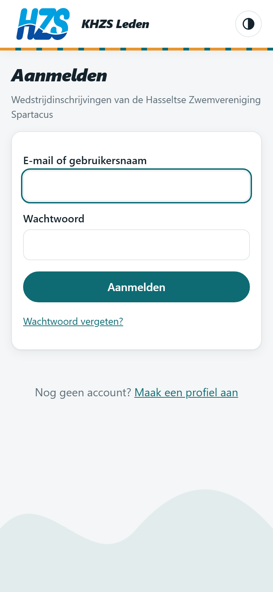

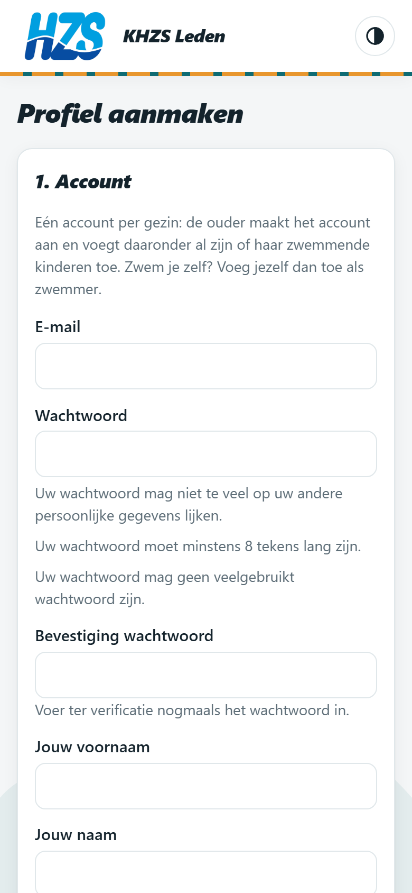

## 3. Het stappenplan

Na het aanmaken stelt de app je drie korte vragen, één per scherm. Elke vraag kan je **overslaan** en later opnieuw doen via **Mijn rollen → Stappenplan**.

1. **Zwem je zelf?** (bv. bij de masters) Vul je geboortedatum en geslacht aan en kies je ploeg. Je krijgt de rol *zwemmer*.
2. **Heb je kinderen die zwemmen?** Voeg elk kind toe met voornaam, naam, geboortedatum, geslacht en ploeg. Staat je kind al bij de andere ouder? Vul dan de **koppelcode** in (zie stap 4). Je krijgt de rol *ouder*.
3. **Help je mee bij de club?** Ben je trainer (competitie of zwemschool), bestuurder of sportsecretaris, duid het dan aan. Het bestuur keurt je aanvraag goed en je krijgt daarna een melding.

Een overzicht toont daarna je rollen, je zwemmers en hun ploegen.

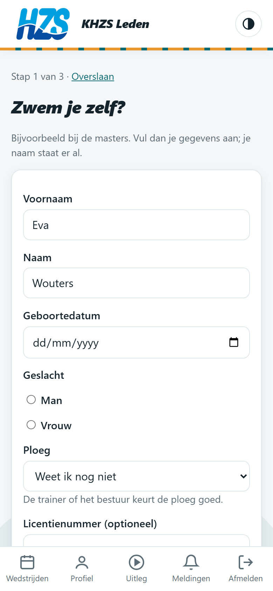

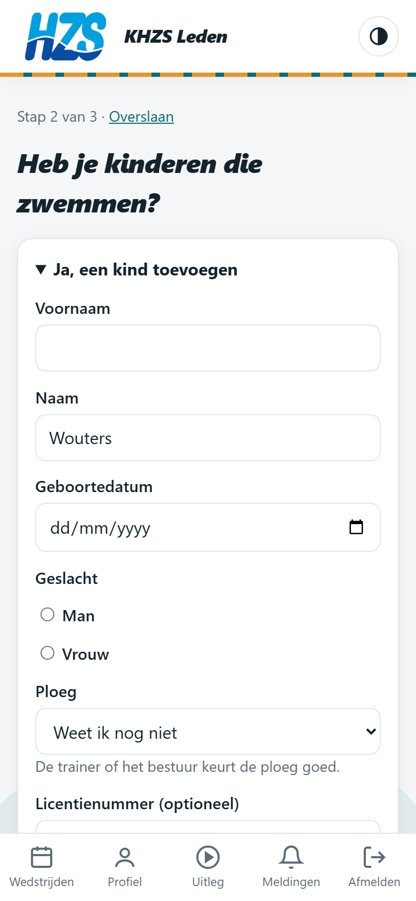

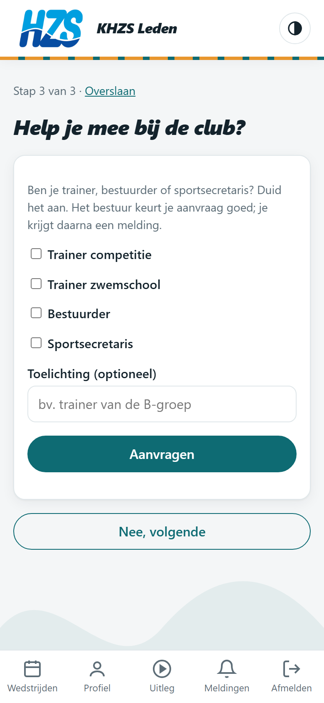

> Voeg je een zwemmer **jonger dan 18 jaar** toe, dan bevestig je dat je ouder of voogd bent en toestemming geeft. Voor kinderen die al in de app stonden, vraagt de pagina van de zwemmer die toestemming één keer achteraf.

Later nog iemand toevoegen kan via **Profiel → + Zwemmer** (op een pc heet dat menu *Mijn zwemmers*). Jezelf toevoegen kan met **+ Mezelf**.

> Je **geboortedatum** bepaalt je categorie. Je ziet daardoor enkel de nummers waarop je mag inschrijven.

## 4. Een zwemmer delen met de andere ouder

Wonen de ouders apart? Dan kunnen jullie elk met een eigen account dezelfde zwemmer volgen. Jullie zien allebei dezelfde inschrijvingen en krijgen allebei de meldingen.

1. De ouder die de zwemmer al in de app heeft, opent **Profiel** → de zwemmer → **🔗 Koppelcode maken**.
2. Geef de code van 8 tekens door (bv. via sms). Ze is **7 dagen** geldig.
3. De andere ouder vult de code in bij **Profiel → Zwemmer koppelen**, of in het stappenplan bij *Mijn kind staat al bij de andere ouder*.

Bij de zwemmer zie je welke accounts gekoppeld zijn. Met **Mij loskoppelen** haal je de zwemmer uit je eigen account. Lukt het niet? De trainer of het sportsecretariaat kan een account ook rechtstreeks koppelen.

> Een melding die de ene ouder gelezen heeft, staat ook bij de andere ouder als gelezen.

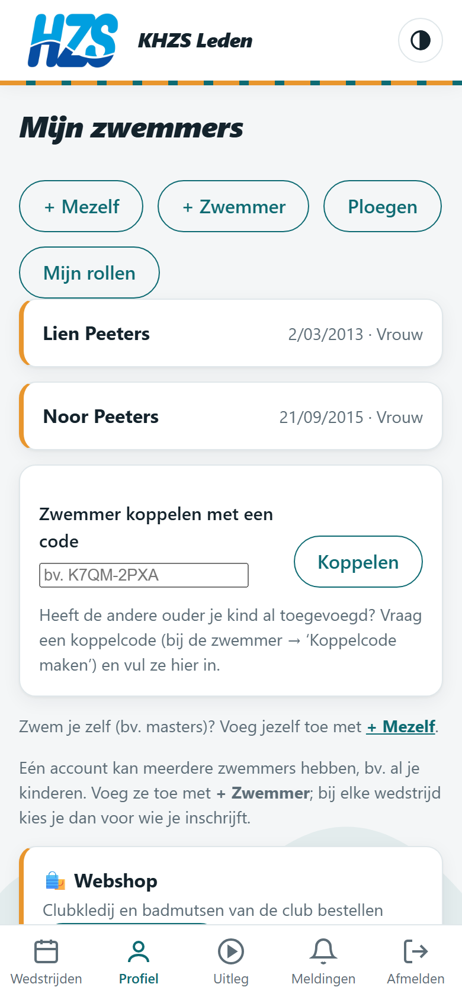

## 5. Je ploeg kiezen

Elke zwemmer hoort bij een of meer **ploegen** (bv. Competitie A, Masters of een groep van de zwemschool).

1. Open **Profiel** → de zwemmer. Kies onder **Ploegen** bij *Ploeg kiezen* de ploeg en tik op **Aanvragen**.
2. De aanvraag staat op *Wacht op goedkeuring* tot een trainer van die ploeg of het bestuur ze goedkeurt.
3. Je krijgt een melding als de aanvraag behandeld is. Met ✕ trek je een aanvraag in of ga je uit een ploeg.

Je ziet enkel de ploegen van je eigen zwemmers. Trainers en bestuur zien alle ploegen.

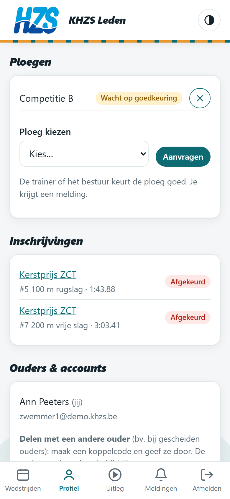

## 6. Je beste tijden

Bij de zwemmer zie je de beste tijden per slag, afstand en badlengte (25 m of 50 m). Je vult ze niet zelf in: de club werkt ze bij op basis van de **wedstrijduitslagen**.

- De app gebruikt de beste tijd als **inschrijftijd** en controleert er de **limieten** mee.
- Een limiet geldt voor een bepaalde badlengte: een tijd in een 25 m-bad telt niet voor een limiet in 50 m.
- Vul bij de gegevens het **Swimrankings-ID** in (het getal achter `athleteId=` in de link van de Swimrankings-pagina). Je krijgt dan een knop **Bekijk op Swimrankings**.
- Klopt er een tijd niet? Laat het de trainer weten.

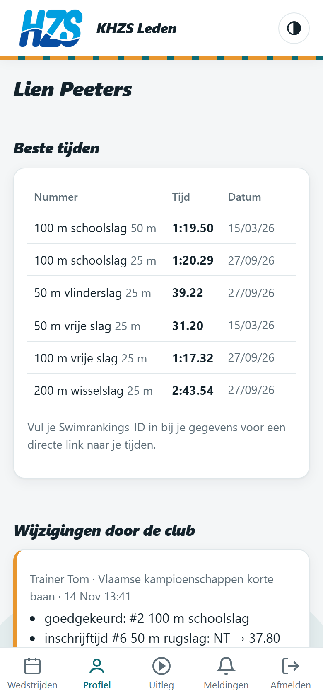

## 7. Een wedstrijd kiezen

Onder **Wedstrijden** zie je alle komende wedstrijden, zodra het sportsecretariaat ze heeft opgeladen.

- **Nog niet open:** je kan al aangeven of je wil meedoen.
- **Inschrijven tot …:** je persoonlijke deadline. Daarna kan je niets meer wijzigen.

## 8. Doe je mee?

Lees eerst de **info van de club** bovenaan de wedstrijd (bv. voor wie de wedstrijd bedoeld is). Soms zijn er ook **bijlagen** 📎, zoals een busregeling of het reglement: tik erop om ze te openen.
Kies dan **Interesse**, **Ik doe mee** of **Ik doe niet mee**.
Trainers en sportsecretariaat zien jouw keuze. Met *Interesse* of *Ik doe mee* krijg je meldingen wanneer de inschrijvingen openen en een dag voor je deadline.

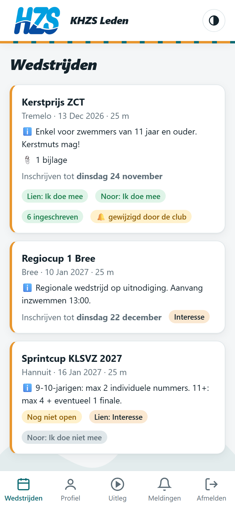

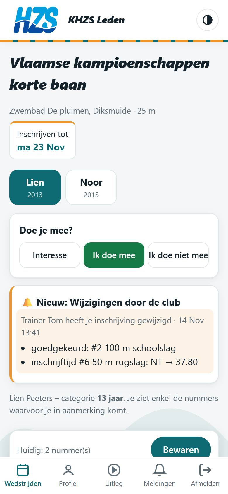

## 9. Inschrijven op nummers

1. Kies (als ouder) de zwemmer met de knoppen bovenaan.
2. Vink de nummers aan die je wil zwemmen. Bij elk nummer zie je:
   - je beste tijd en de limiet;
   - **limiet ✓** (groen) of **geen limiet** (rood): zonder limiet kan je dat nummer niet aanvinken.
3. Tik op **Bewaren**. Je inschrijving staat op **Ingediend** tot een trainer ze nakijkt.

Tot je deadline kan je alles nog **wijzigen**: nummers bijvoegen of schrappen, ook als ze al goedgekeurd zijn.
Heeft je trainer je inschrijving **gefinaliseerd** (🔒)? Dan ligt ze vast en kan je enkel nog via je trainer iets laten aanpassen.

## 10. Wijzigingen door de club

Past een trainer of het sportsecretariaat je inschrijving aan (bijvoorbeeld goedkeuren, afkeuren, je inschrijftijd wijzigen of je **deelname weigeren**)? Dan zie je dat bovenaan de wedstrijd onder **Wijzigingen door de club**. In de lijst van wedstrijden staat er een 🔔-label bij.

Werd je deelname **geweigerd**? Dan zie je de reden bovenaan de wedstrijd en kan je voor die wedstrijd niet meer inschrijven.

## 11. Berichten

Onder **Berichten** praat je met je ploeg en de club, zoals in een chatapp.

- **Opbouw**: secties (*Algemeen*, *Competitie*, *Zwemschool*) met daaronder kanalen. Elke ploeg heeft een eigen kanaal, en elke wedstrijd een eigen gesprek (*thread*) met de deelnemers, hun ouders en de trainers. Je ziet enkel de kanalen van je eigen ploegen en wedstrijden.
- **Posten** kan in de kanalen waar de trainer dat toelaat. In *Algemeen* posten enkel trainers en bestuur.
- Typ **@** en een naam om iemand te vermelden: die persoon krijgt een melding. Je eigen berichten kan je bewerken en verwijderen.
- **Aankondigingen** staan bovenaan, met een kleur per soort: *Informatief*, *Dringend*, *Aankondiging* of *Vraag naar hulp*.
- Bij een **vraag naar hulp** (bv. helpers voor de pastadag) antwoord je met **Ja**, **Misschien** of **Nee**, met hoeveel personen je komt en eventueel een opmerking. Je ziet hoeveel mensen er al komen.
- Met 🔕 **demp** je een kanaal; een vermelding komt altijd door. Het getal bij *Berichten* toont wat je nog niet las.

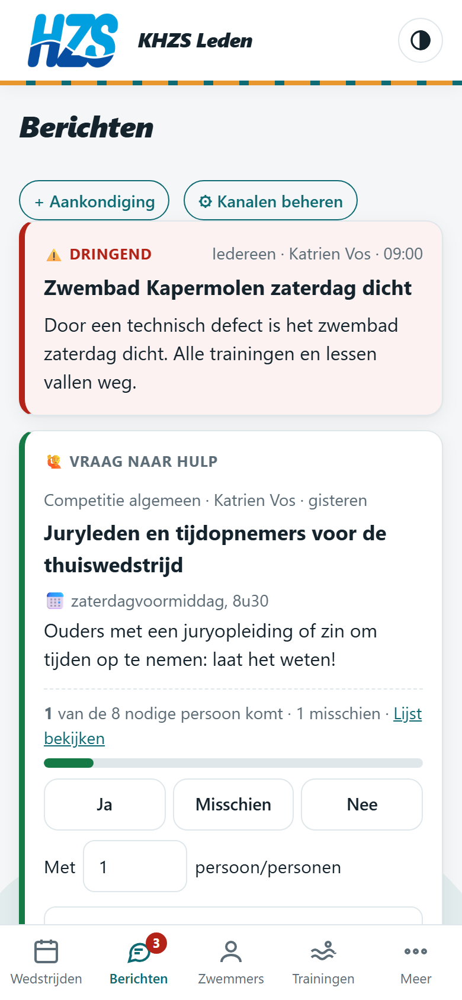

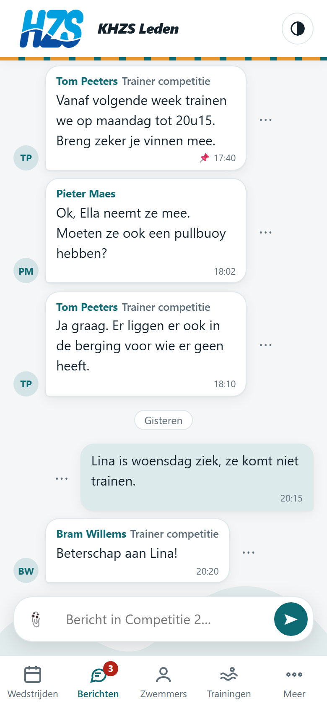

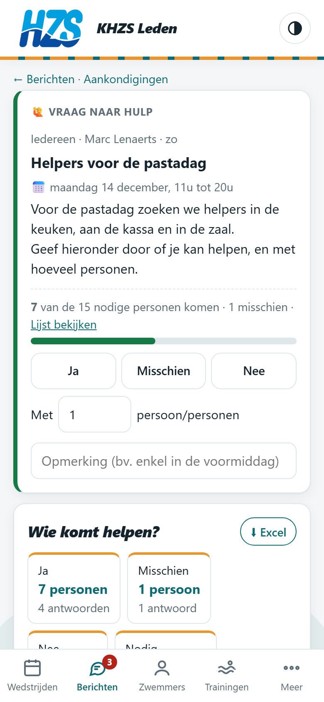

## 12. Aanwezigheid op trainingen

De trainers duiden na elke training aan wie er was (eventueel met *te laat*, *vroeger weg* of *ziek*). Je hoeft zelf niets te bevestigen.

- Op de pagina van de zwemmer staat het kaartje **Trainingen** met het percentage aanwezig. Tik erop voor de volledige statistiek: per maand, per training en per weekdag, de langste reeks na elkaar en een tijdlijn.
- Een zwemmer ziet enkel de eigen cijfers, een ouder die van de eigen kinderen. Van de ploeg zie je alleen het gemiddelde.

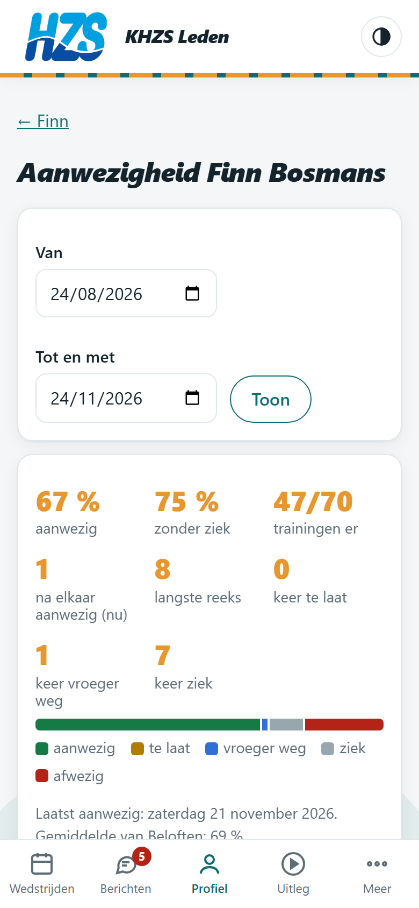

## 13. Meldingen

Onder **Meldingen** zet je pushmeldingen aan op je toestel en kies je waarvoor:

| Melding | Wanneer |
|---|---|
| Nieuwe wedstrijd | Het secretariaat laadt een wedstrijd op |
| Inschrijvingen open | Enkel voor wedstrijden met *Interesse* of *Ik doe mee* |
| Herinnering deadline | 1 dag voor je deadline, enkel bij *Interesse* of *Ik doe mee* |
| Wijziging door de club | Een trainer of het secretariaat past je inschrijving aan |
| Aanvraag behandeld | Je aanvraag voor een rol of een ploeg is goedgekeurd of afgekeurd |
| Berichten *(WordPress)* | Nieuw bericht in je kanaal, iemand vermeldt je, nieuwe aankondiging, nieuwe vraag naar hulp |

Meldingen komen als **pushmelding** op je gsm of computer (geen sms, mail of chatapp).

> Op iPhone werken meldingen enkel als je de app eerst op je beginscherm zette (stap 1).

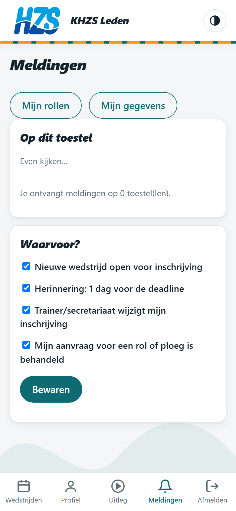

## 14. Mijn rollen

Onder **Mijn rollen** (knop bovenaan *Meldingen*) zie je welke rollen je hebt: zwemmer, ouder, trainer, bestuurder… Een account kan er meerdere hebben.

- Een extra rol aanvragen: kies de rol en geef eventueel een toelichting. *Zwemmer* en *ouder* krijg je meteen; de andere rollen keurt het bestuur goed.
- Een open aanvraag kan je intrekken. Een beslissing zie je bovenaan elke pagina tot je *Mijn rollen* opent.

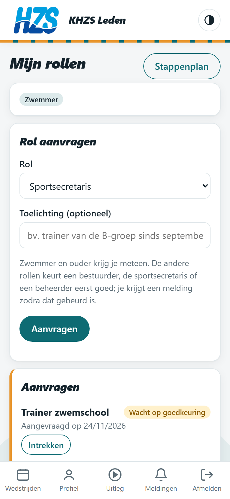

## 15. Privacy en je gegevens

- De **privacyverklaring** (link bij *Aanmelden* en *Uitleg*) legt uit welke gegevens de club bijhoudt en waarom. Verandert ze, dan vraagt de app je ze opnieuw te lezen en te bevestigen.
- Onder **Mijn gegevens** (knop bovenaan *Meldingen*) download je al je gegevens als bestand, of verwijder je je account. Een zwemmer die je deelt met de andere ouder, blijft bij die ouder.
- De app gebruikt enkel cookies die nodig zijn om aangemeld te blijven: geen reclame of statistieken.

## 16. Webshop, uitleg en thema

- **Webshop**: bij *Profiel* (en op de pc bovenaan) staat een knop naar de webshop van de club voor clubkledij en badmutsen.
- **Uitleg**: instructiefilmpjes met gesproken uitleg en ondertitels, en deze handleiding als PDF.
- Met de knop ◐ naast het logo wissel je tussen automatisch, licht en donker thema.

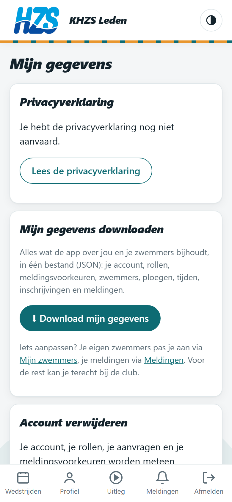

