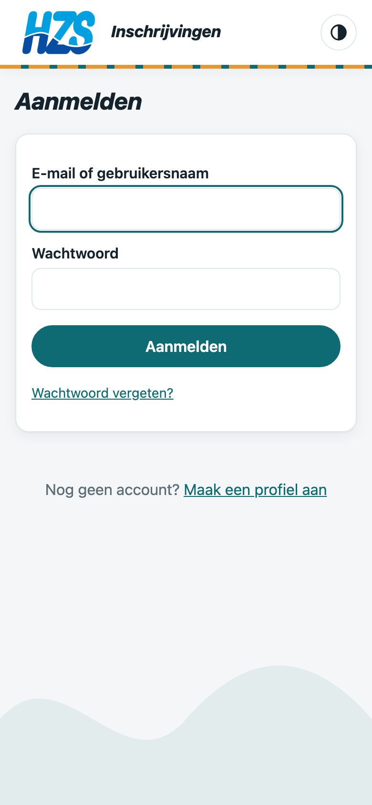
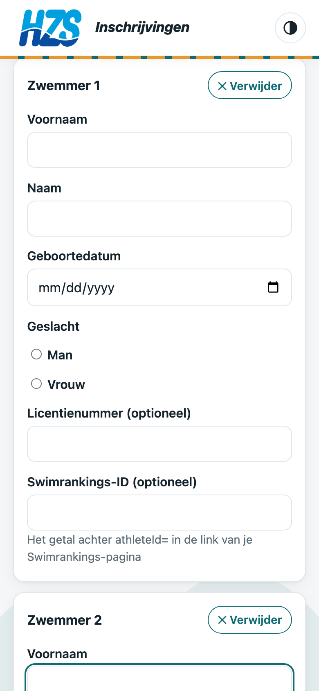
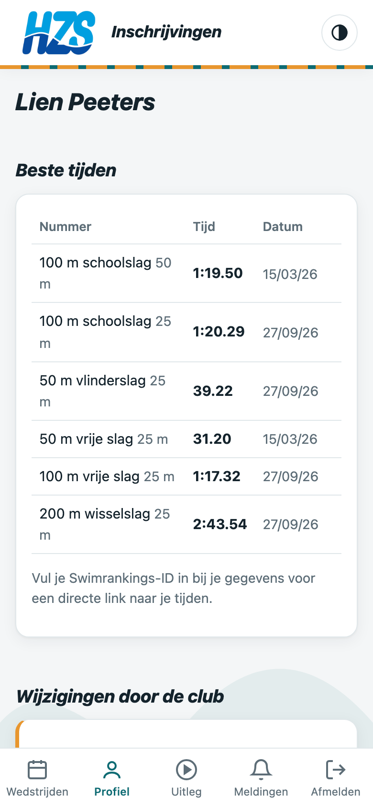
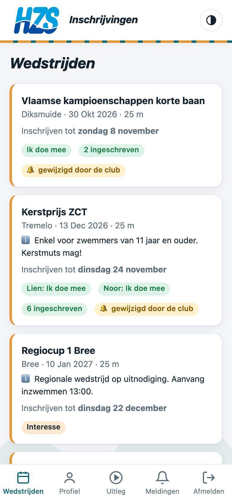
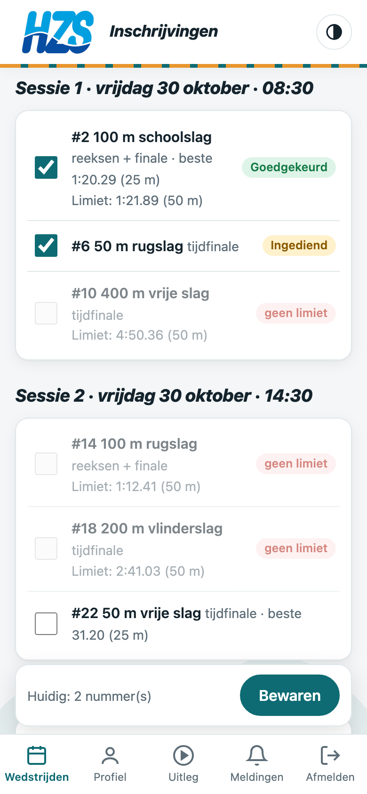
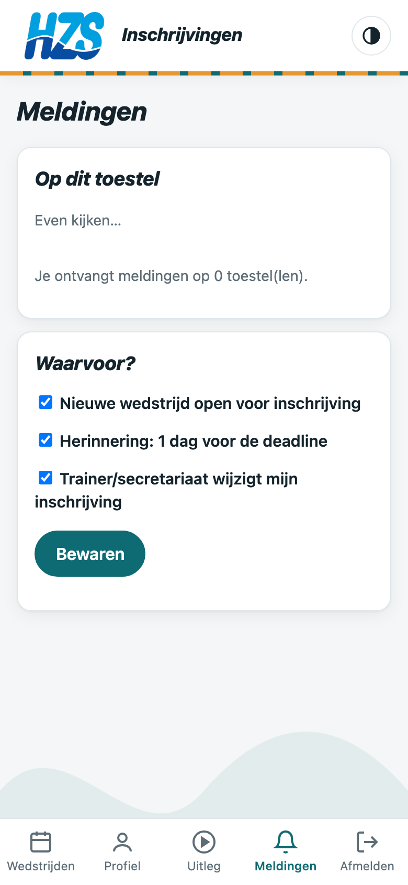
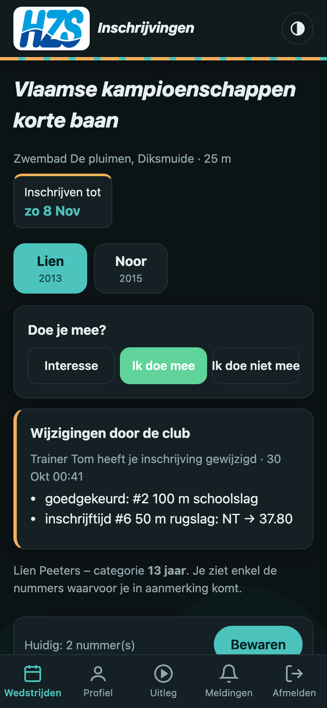

# Handleiding zwemmers & ouders

Met de app **HZS inschrijvingen** schrijf je je in voor zwemwedstrijden, vanop je gsm of computer.
Ouders beheren alle zwemmers van het gezin vanuit één account.

## 1. De app installeren

1. Surf op je gsm naar **https://inschrijvingen.khzs.be**
2. **iPhone:** tik op Delen ⬆ → *Zet op beginscherm*. **Android:** tik op *Installeer als app* (of ⋮ → *App installeren*).
3. Open voortaan de app via het HZS-icoon op je beginscherm.

## 2. Profiel aanmaken (één account per gezin)

1. Tik op **Maak een profiel aan**.
2. **Account:** vul je e-mailadres, je eigen voornaam en naam en een wachtwoord in. Als ouder gebruik je je eigen gegevens.
3. **Zwemmer(s):** vul per kind voornaam, naam, geboortedatum en geslacht in. Licentienummer en Swimrankings-ID zijn optioneel.
4. Meerdere kinderen? Tik op **+ Nog een zwemmer (broer/zus)**. Zwem je zelf? Voeg jezelf ook toe als zwemmer.
5. Later nog iemand toevoegen kan via **Profiel → + Zwemmer**.

Bij elke wedstrijd kies je bovenaan met de knoppen per kind voor wie je inschrijft. Meldingen komen op het ene account toe.

> Je **geboortedatum** bepaalt je categorie. Je ziet daardoor enkel de nummers waarop je mag inschrijven.

## 3. Je beste tijden

Onder **Profiel** zie je je beste tijden per slag, afstand en badlengte (25 m of 50 m). Je vult ze niet zelf in: de club werkt ze bij op basis van de **wedstrijduitslagen**.

- De app gebruikt je beste tijd als **inschrijftijd** en controleert er de **limieten** mee.
- Een limiet geldt voor een bepaalde badlengte: een tijd in een 25 m-bad telt niet voor een limiet in 50 m.
- Vul bij je gegevens je **Swimrankings-ID** in (het getal achter `athleteId=` in de link van je Swimrankings-pagina). Je krijgt dan een knop **Bekijk op Swimrankings**.
- Klopt er een tijd niet? Laat het je trainer weten.

## 4. Een wedstrijd kiezen

Onder **Wedstrijden** zie je alle komende wedstrijden, zodra het sportsecretariaat ze heeft opgeladen.

- **Nog niet open:** je kan al aangeven of je wil meedoen.
- **Inschrijven tot …:** je persoonlijke deadline. Daarna kan je niets meer wijzigen.

## 5. Doe je mee?

Lees eerst de **info van de club** bovenaan de wedstrijd (bv. voor wie de wedstrijd bedoeld is).
Kies dan **Interesse**, **Ik doe mee** of **Ik doe niet mee**.
Trainers en sportsecretariaat zien jouw keuze. Met *Interesse* of *Ik doe mee* krijg je meldingen wanneer de inschrijvingen openen en een dag voor je deadline.

## 6. Inschrijven op nummers

1. Kies (als ouder) de zwemmer.
2. Vink de nummers aan die je wil zwemmen. Bij elk nummer zie je:
   - je beste tijd en de limiet;
   - **limiet ✓** (groen) of **geen limiet** (rood): zonder limiet kan je dat nummer niet aanvinken.
3. Tik op **Bewaren**. Je inschrijving staat op **Ingediend** tot een trainer ze nakijkt.

Tot je deadline kan je alles nog **wijzigen**: nummers bijvoegen of schrappen, ook als ze al goedgekeurd zijn.
Heeft je trainer je inschrijving **gefinaliseerd** (🔒)? Dan ligt ze vast en kan je enkel nog via je trainer iets laten aanpassen.

## 7. Wijzigingen door de club

Past een trainer of het sportsecretariaat je inschrijving aan (bijvoorbeeld goedkeuren, afkeuren, je inschrijftijd wijzigen of je **deelname weigeren**)? Dan zie je dat bovenaan de wedstrijd onder **Wijzigingen door de club**. In de lijst van wedstrijden staat er een 🔔-label bij.

Werd je deelname **geweigerd**? Dan zie je de reden bovenaan de wedstrijd en kan je voor die wedstrijd niet meer inschrijven.

## 8. Meldingen

Onder **Meldingen** zet je pushmeldingen aan op je toestel en kies je waarvoor:

| Melding | Wanneer |
|---|---|
| Nieuwe wedstrijd | Het secretariaat laadt een wedstrijd op |
| Inschrijvingen open | Enkel voor wedstrijden met *Interesse* of *Ik doe mee* |
| Herinnering deadline | 1 dag voor je deadline, enkel bij *Interesse* of *Ik doe mee* |
| Wijziging door de club | Een trainer of het secretariaat past je inschrijving aan |

> Op iPhone werken meldingen enkel als je de app eerst op je beginscherm zette (stap 1).

## 9. Uitleg en filmpje

Onder **Uitleg** vind je een instructiefilmpje met gesproken uitleg (en ondertitels), en deze handleiding als PDF.

## 10. Licht of donker

Met de knop ◐ naast het logo wissel je tussen automatisch, licht en donker thema.

