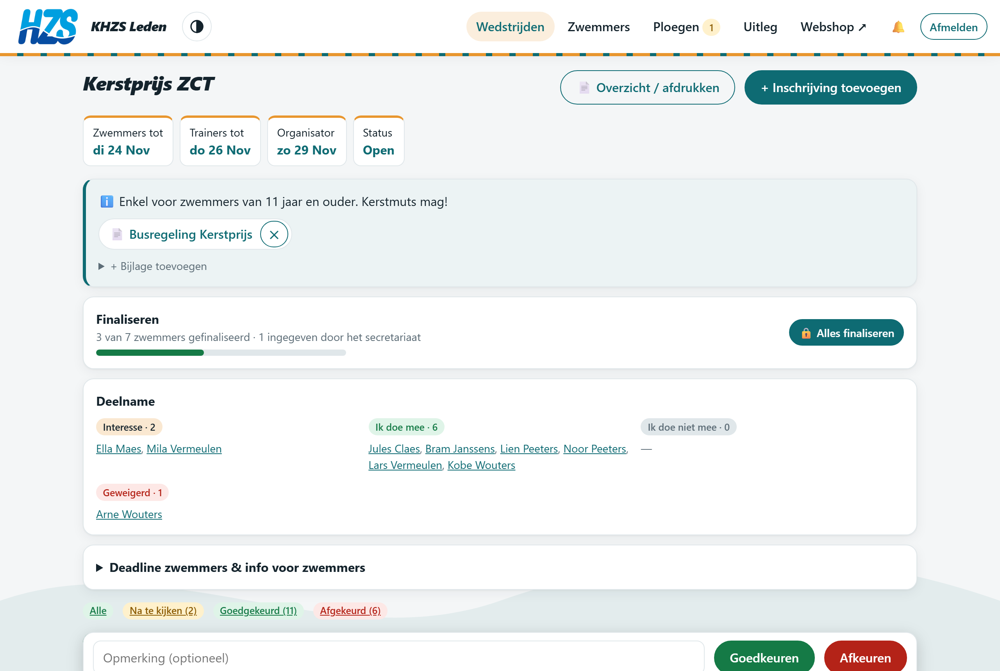

# Onepager trainers

## Elke wedstrijd (trainer competitie)

1. **Wedstrijden** → open de wedstrijd. Stel bij **Deadline zwemmers & info** je extra dagen en eventuele info in.
2. Bekijk bij **Deelname** wie interesse heeft of meedoet.
3. Filter op **Na te kijken**, vink inschrijvingen aan → **Goedkeuren** of **Afkeuren** (met opmerking).
4. Aanpassen: **wijzigen** bij een zwemmer → nummers of inschrijftijd wijzigen → **Bewaren**.
5. Alles nagekeken? **🔒 Finaliseren** per zwemmer of **Alles finaliseren**: het secretariaat kan dan ingeven.
6. **📄 Overzicht / afdrukken** voor de laatste controle; deelname niet ok? Open de zwemmer → reden → **Weigeren**.
7. Na een wedstrijd: **Zwemmers → Uitslagen importeren** om de beste tijden bij te werken.

## Je ploeg (competitie en zwemschool)

- **Ploegen** → je ploeg: aanvragen **Goedkeuren** of **Afkeuren**, zwemmers toevoegen of uit de ploeg halen.
- Een trainer van de zwemschool ziet geen wedstrijden, enkel de ploegen van de zwemschool.

## Trainingen *(WordPress-versie)*

- **Trainingen**: je schema, **Kan niet** (collega's krijgen een melding) of **Ik neem over**; kalender per dag, week of maand.
- Na elke training: pushmelding **Was je aanwezig?** → **✓ Ja** of **✗ Nee**. Enkel bevestigde trainingen tellen voor je uren.
- **Zwemmers aanduiden**: iedereen staat aangevinkt, vink af wie er niet was (of *te laat*, *vroeger weg*, *ziek*) → **Bewaar**.
- **Berichten**: kanaal van je ploeg, vastpinnen, threads, aankondigingen en vragen naar hulp.

