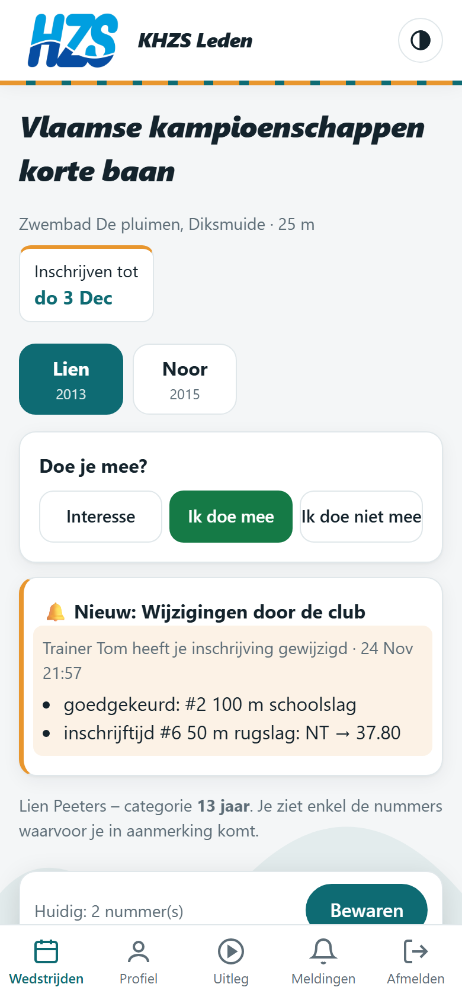
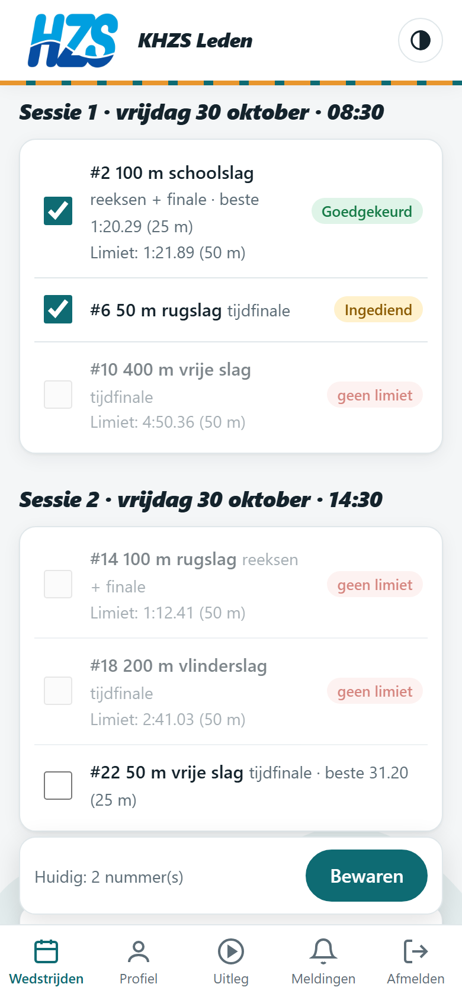

# Onepager zwemmers & ouders

## In 6 stappen ingeschreven

1. Surf naar **inschrijvingen.khzs.be** en zet de app **KHZS Leden** op je beginscherm.
2. **Maak een profiel aan**: één account per gezin, met je eigen naam. Het **stappenplan** vraagt daarna: zwem je zelf, heb je kinderen die zwemmen (met hun **ploeg**), help je mee bij de club?
3. **Profiel** → je zwemmer: controleer de ploeg en de beste tijden (de club houdt ze bij via de uitslagen) en vul het Swimrankings-ID in.
4. **Wedstrijden** → kies een wedstrijd → lees de info → **Interesse**, **Ik doe mee** of **Ik doe niet mee**.
5. Vink je nummers aan (groen = limiet gehaald) en tik **Bewaren**.
6. Volg de status: *Ingediend* → *Goedgekeurd* door je trainer.

## Goed om te weten

- Je kan wijzigen tot de datum bij **Inschrijven tot**. Je ziet enkel nummers voor jouw leeftijd en geslacht.
- Zet **Meldingen** aan: herinnering een dag voor je deadline, wijzigingen door je trainer, je aanvraag voor een ploeg of rol.
- Ouders: voeg broers of zussen toe via **Profiel → + Zwemmer**, of jezelf met **+ Mezelf**.
- Gescheiden ouders: maak bij de zwemmer een **🔗 Koppelcode** en geef ze aan de andere ouder. Die vult ze in bij **Zwemmer koppelen**.
- **Mijn gegevens** (bij *Meldingen*): al je gegevens downloaden of je account verwijderen.
- **Webshop**: clubkledij en badmutsen via de knop bij *Profiel*.
- Op de website van de club *(WordPress-versie)* ook: **Berichten** met je ploeg en aankondigingen (antwoord *Ja / Misschien / Nee* op een vraag naar hulp), en de **aanwezigheid** van je kind op trainingen.

